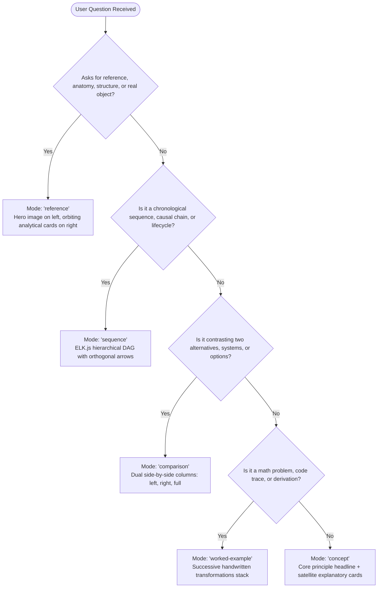
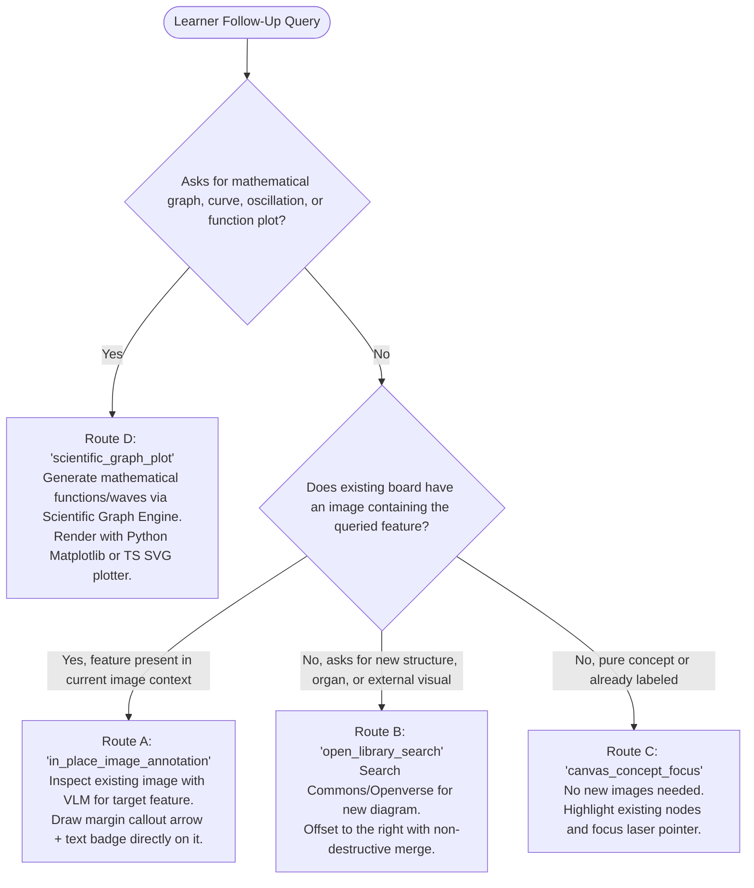
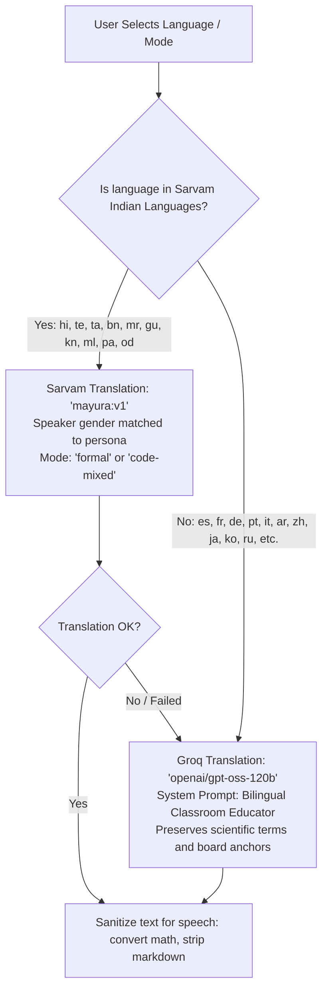
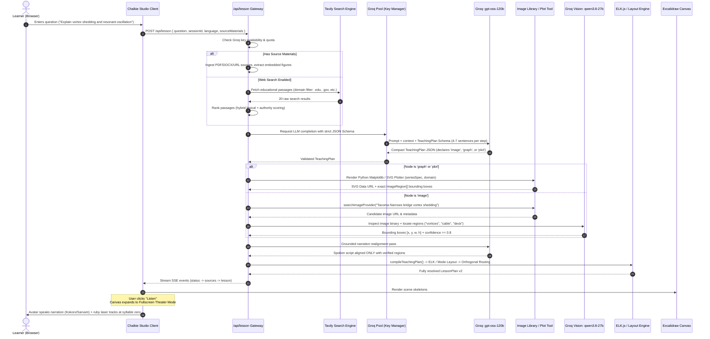
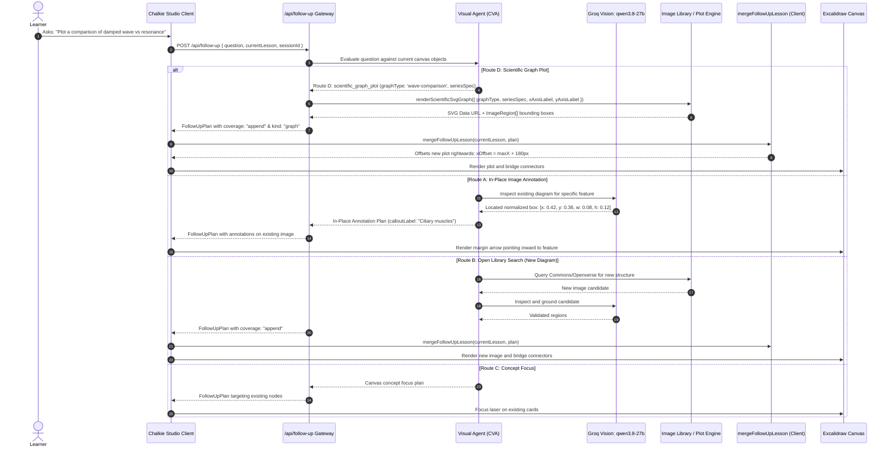
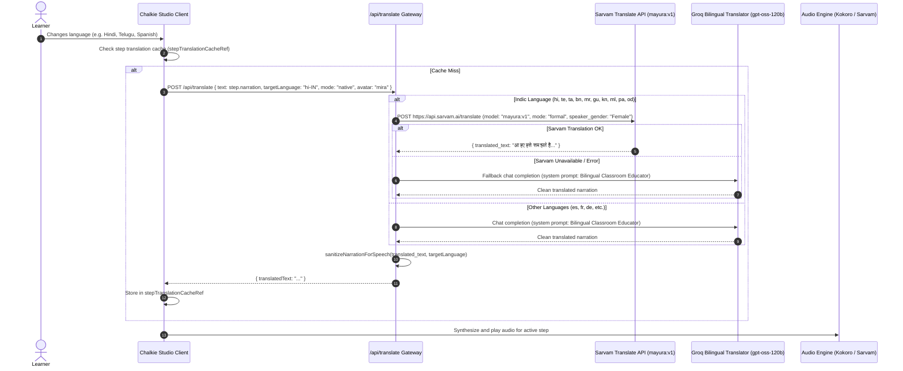
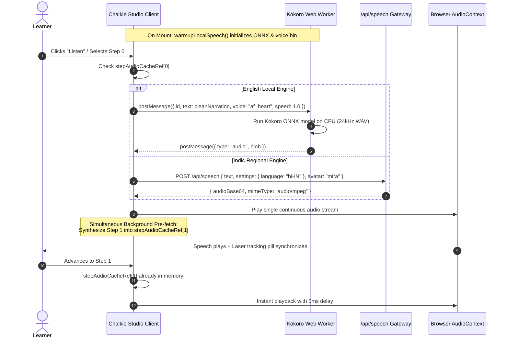

# Chalkie 2.0 — Architecture, Decision Systems, Tools & Complete Specification

> **The Definitive Engineering Bible for Chalkie 2.0.**  
> This document provides an exhaustive, granular breakdown of how Chalkie 2.0 works: its cognitive decisions, complete tool inventory, deterministic layout algorithms, vision grounding pipeline, visual agent routing, failover mechanics, audio-visual alignment, and dataflow lifecycle. Every schema and specification in this document mirrors the live codebase and AI models with 100% fidelity.

---

## Table of Contents
1. [Executive Overview & First Principles](#1-executive-overview--first-principles)
2. [Complete Tool & Subsystem Catalog (24 Subsystems)](#2-complete-tool--subsystem-catalog-24-subsystems)
3. [Decision Systems & Decision Matrices](#3-decision-systems--decision-matrices)
   - [3.1 Pedagogical Mode Decision Matrix](#31-pedagogical-mode-decision-matrix)
   - [3.2 Visual Sourcing & Trigger Matrix](#32-visual-sourcing--trigger-matrix)
   - [3.3 Visual Agent 4-Route Decision Matrix (Routes A, B, C, D)](#33-visual-agent-4-route-decision-matrix-routes-a-b-c-d)
   - [3.4 Elimination of Shading Boxes in Favor of Precision Margin Arrows](#34-elimination-of-shading-boxes-in-favor-of-precision-margin-arrows)
   - [3.5 Image Provider & License Decision Matrix](#35-image-provider--license-decision-matrix)
   - [3.6 Vision Model Acceptance & Rejection Matrix](#36-vision-model-acceptance--rejection-matrix)
   - [3.7 Spatial Layout Engine Dispatch Matrix (ELK vs Custom)](#37-spatial-layout-engine-dispatch-matrix-elk-vs-custom)
   - [3.8 Connector Port & Orthogonal Routing Matrix](#38-connector-port--orthogonal-routing-matrix)
   - [3.9 Speech Engine & Voice Selection Matrix](#39-speech-engine--voice-selection-matrix)
   - [3.10 Multilingual Translation & Code-Switching Matrix](#310-multilingual-translation--code-switching-matrix)
   - [3.11 Source Materials Ingestion Matrix](#311-source-materials-ingestion-matrix)
4. [Master Schemas & Data Dictionaries](#4-master-schemas--data-dictionaries)
   - [4.1 Compact Pedagogical Plan: `TeachingPlan` (Deep Pedagogy Edition)](#41-compact-pedagogical-plan-teachingplan-deep-pedagogy-edition)
   - [4.2 Canonical Blackboard Scene: `LessonPlan` (v2)](#42-canonical-blackboard-scene-lessonplan-v2)
   - [4.3 Scientific Plotting & Graph Schemas (`PlotSpec` & `GraphRequest`)](#43-scientific-plotting--graph-schemas-plotspec--graphrequest)
   - [4.4 Visual Asset & Grounded Region: `ImageAsset`](#44-visual-asset--grounded-region-imageasset)
   - [4.5 Visual Agent Decision Schemas (`inPlaceAnnotation`, `openLibrarySearch`, `canvasConceptFocus`, `scientificGraphPlot`)](#45-visual-agent-decision-schemas-inplaceannotation-openlibrarysearch-canvasconceptfocus-scientificgraphplot)
   - [4.6 Precision Margin Callout & Arrow Schemas](#46-precision-margin-callout--arrow-schemas)
   - [4.7 Dense VLM Inspection Schema (`qwen/qwen3.8-27b`)](#47-dense-vlm-inspection-schema-qwenqwen38-27b)
   - [4.8 Source Materials Ingestion Schemas (`SourceMaterial` & `SourceImage`)](#48-source-materials-ingestion-schemas-sourcematerial--sourceimage)
   - [4.9 Multilingual & Lesson Language Schemas](#49-multilingual--lesson-language-schemas)
   - [4.10 Speech Request & Response Schemas](#410-speech-request--response-schemas)
   - [4.11 Follow-Up Expansion: `FollowUpPlan` & `FollowUpMerge`](#411-follow-up-expansion-followupplan--followupmerge)
   - [4.12 Research Citation & Excerpt: `ResearchSource`](#412-research-citation--excerpt-researchsource)
   - [4.13 Canvas Playback & Laser Tracking: `CanvasPlaybackState`](#413-canvas-playback--laser-tracking-canvasplaybackstate)
5. [End-to-End Dataflow & Workflow Sequences](#5-end-to-end-dataflow--workflow-sequences)
   - [5.1 Primary Lesson Generation Lifecycle](#51-primary-lesson-generation-lifecycle)
   - [5.2 Interactive Follow-Up via Visual Agent (Routes A, B, C, D)](#52-interactive-follow-up-via-visual-agent-routes-a-b-c-d)
   - [5.3 On-the-Fly Multilingual Translation Lifecycle](#53-on-the-fly-multilingual-translation-lifecycle)
   - [5.4 Unified Audio Playback, Kokoro Synthesis & Zero-Latency Pre-Fetching](#54-unified-audio-playback-kokoro-synthesis--zero-latency-pre-fetching)
   - [5.5 Error Recovery, Fallback & Self-Healing Loops](#55-error-recovery-fallback--self-healing-loops)
6. [Subsystems Deep Dive](#6-subsystems-deep-dive)
   - [6.1 Research & RAG Engine (`lib/research.ts`)](#61-research--rag-engine-libresearchts)
   - [6.2 Groq Quota Pool & Multi-Key Failover (`lib/groq-pool-core.ts`)](#62-groq-quota-pool--multi-key-failover-libgroq-pool-corets)
   - [6.3 Keyless Scientific Graph & Mathematical Plot Engine (`lib/plot-tool.ts`, `lib/graph-generator.ts`)](#63-keyless-scientific-graph--mathematical-plot-engine-libplot-toolts-libgraph-generatorts)
   - [6.4 Source Materials & Document RAG Engine (`lib/source-materials.ts`, `lib/document-import.ts`)](#64-source-materials--document-rag-engine-libsource-materialsts-libdocument-importts)
   - [6.5 Image Sourcing & Fetch Guard (`lib/image-providers.ts`, `lib/commons-fetch.ts`)](#65-image-sourcing--fetch-guard-libimage-providersts-libcommons-fetchts)
   - [6.6 Vision Model Inspection & Grounding (`lib/image-library.ts`)](#66-vision-model-inspection--grounding-libimage-libraryts)
   - [6.7 Visual Agent Autonomous Follow-Up Engine (`lib/visual-agent.ts`)](#67-visual-agent-autonomous-follow-up-engine-libvisual-agentts)
   - [6.8 Precision Margin Callouts & Concentric Shell Router (`lib/image-annotations.ts`)](#68-precision-margin-callouts--concentric-shell-router-libimage-annotationsts)
   - [6.9 Mathematical & Spoken Text Sanitizer (`lib/local-speech.ts`, `lib/speech-formatter.ts`)](#69-mathematical--spoken-text-sanitizer-liblocal-speechts-libspeech-formatterts)
   - [6.10 Multilingual Translation & Code-Switching Engine (`lib/lesson-language.ts`, `app/api/translate/route.ts`)](#610-multilingual-translation--code-switching-engine-liblesson-languagets-appapitranslateroutets)
   - [6.11 Client-Side Kokoro Neural TTS Engine (`lib/local-speech.ts`, `public/local-speech-worker.js`)](#611-client-side-kokoro-neural-tts-engine-liblocal-speechts-publiclocal-speech-workerjs)
   - [6.12 Remote Cloud Speech Synthesizer (`lib/remote-speech.ts`, `app/api/speech/route.ts`)](#612-remote-cloud-speech-synthesizer-libremote-speechts-appapispeechroutets)
   - [6.13 Audio Caching & Pre-Warming Engine (`components/chalkie-studio.tsx`)](#613-audio-caching--pre-warming-engine-componentschalkie-studiotsx)
   - [6.14 Live Ruby Laser Pointer with Sonar Pulsing & Photon Core (`components/chalk-canvas.tsx`)](#614-live-ruby-laser-pointer-with-sonar-pulsing--photon-core-componentschalk-canvastsx)
   - [6.15 Syllable-0 Audio-Visual Alignment Engine (`lib/target-matcher.ts`)](#615-syllable-0-audio-visual-alignment-engine-libtarget-matcherts)
   - [6.16 Master Classroom Deep Pedagogy (`lib/lesson-v2.ts`, `lib/grounded-narration.ts`)](#616-master-classroom-deep-pedagogy-liblesson-v2ts-libgrounded-narrationts)
   - [6.17 Fullscreen Whiteboard Theater Mode & Translucent Glassmorphism Backdrop](#617-fullscreen-whiteboard-theater-mode--translucent-glassmorphism-backdrop)
   - [6.18 Spatial Layout & Orthogonal Routing Engine](#618-spatial-layout--orthogonal-routing-engine)
   - [6.19 Progressive Canvas Engine (`components/chalk-canvas.tsx`)](#619-progressive-canvas-engine-componentschalk-canvastsx)
   - [6.20 Animated Teacher Personas (`components/teacher-avatar.tsx`)](#620-animated-teacher-personas-componentsteacher-avatartsx)
   - [6.21 Non-Destructive Follow-Up Merger (`lib/follow-up.ts`)](#621-non-destructive-follow-up-merger-libfollow-upts)
7. [API Endpoints & Server Protocols](#7-api-endpoints--server-protocols)
8. [Concrete End-to-End Execution Traces](#8-concrete-end-to-end-execution-traces)

---

## 1. Executive Overview & First Principles

**Chalkie 2.0** is an autonomous, multimodal AI educator that teaches on an infinite digital blackboard. Instead of streaming text walls into a chatbot window, Chalkie behaves like a world-class human professor:
- **Draws structured visual diagrams** on an infinite dark blackboard canvas.
- **Renders precision scientific plots and mathematical waveforms** locally without external API dependencies.
- **Sources authentic CC-licensed reference diagrams** from Wikimedia Commons and Openverse.
- **Inspects images with a computer vision model** (`qwen/qwen3.8-27b`) to locate and highlight precise anatomical, mechanical, or physical regions in real time.
- **Teaches with deep classroom pedagogy**: Explains from first principles with zero-prior-knowledge assumptions (4–7 comprehensive sentences per step, unpacking definitions, mechanisms, and real-world intuition).
- **Employs an Autonomous Visual Agent (CVA)** to route learner follow-ups across 4 distinct strategies:
  - **Route A**: `in_place_image_annotation` (places precision margin callouts directly on existing diagram)
  - **Route B**: `open_library_search` (retrieves a new diagram from Commons/Openverse)
  - **Route C**: `canvas_concept_focus` (focuses laser pointer and highlights existing board elements)
  - **Route D**: `scientific_graph_plot` (generates mathematical functions, wave comparisons, and plots)
- **Translates lesson narration on-the-fly** into 23 languages using Sarvam `mayura:v1` for Indic languages and bilingual Groq `openai/gpt-oss-120b` fallback, supporting both native script and natural code-switching modes.
- **Delivers human-speed neural speech synthesis**:
  - **Tier 1 (Default English)**: Client-side Kokoro-82M ONNX Web Worker (`onnx-community/Kokoro-82M-v1.0-ONNX`, dtype: q8) running at 24kHz with zero API costs, zero roundtrips, and continuous single-stream audio playback.
  - **Tier 2 (Indic Languages)**: Sarvam `bulbul:v3` via `/api/speech` providing authentic Indian native voices (`hi-IN`, `ta-IN`, `te-IN`, `bn-IN`, `mr-IN`, `gu-IN`, `kn-IN`, `ml-IN`, `pa-IN`, `od-IN`).
  - **Tier 3**: ElevenLabs `eleven_flash_v2_5` with word timestamps.
  - **Tier 4**: Browser Web Speech API (`window.speechSynthesis`).
- **Points with a live ruby laser pointer** (`#ff0033`) featuring a glowing white photon core (`#ffffff`) and outward sonar pulsing ripples, guiding learner attention to the exact pixel.
- **Sanitizes mathematical equations for speech**: Converts LaTeX fractions, roots, powers, exponents, Greek variables, and operators into natural spoken English or Hindi without reading asterisks or markdown formatting.
- **Aligns audio and visuals at syllable zero** with parenthetical acronym indexing and progressive visibility filtering.
- **Expands into Fullscreen Theater Mode with a translucent glassmorphic backdrop** when the user clicks "Listen", giving the whiteboard maximum breathing room.
- **Supports seamless interactive follow-ups**, expanding upon the existing board non-destructively without erasing previous learning.

### The Core Architectural Tenets
1. **"LLMs reason pedagogically; deterministic algorithms layout spatially."**  
   Language models hallucinate coordinate geometry, overlap cards, and fail at 2D packing. In Chalkie, the LLM plans cognitive relationships; algorithmic engines (`ELK.js`, orthogonal A* routing, coordinate projection math) calculate physical bounding boxes, avoid collisions, and route clean connector lines.
2. **"No visual clutter: point with arrows, never obscure with shading boxes."**  
   Overlaying semi-transparent filled boxes or contour outlines over diagrams obscures underlying labels and textures. Chalkie uses external margin callout badges and precise inward-pointing arrows with zero-overlap concentric shell spacing.
3. **"Audio-visual alignment must be instantaneous and zero-latency."**  
   Laser pointers cannot lag speech. The primary visual target anchors at syllable 0 (`charIndex === 0`). Speech synthesis is warmed up in the background and pre-fetches step $i+1$ audio into memory, delivering 0ms transition latency between steps.

---

## 2. Complete Tool & Subsystem Catalog (24 Subsystems)

Chalkie 2.0 is powered by 24 dedicated internal tools and subsystems:

| # | Subsystem / Tool | Primary Source Files | Responsibility |
| :--- | :--- | :--- | :--- |
| **1** | **Research & RAG Engine** | [`lib/research.ts`](file:///c:/Users/agarw/OneDrive/Desktop/kush/chalkie%202.0/lib/research.ts)<br>[`lib/research-quality.ts`](file:///c:/Users/agarw/OneDrive/Desktop/kush/chalkie%202.0/lib/research-quality.ts)<br>[`lib/research-evidence.ts`](file:///c:/Users/agarw/OneDrive/Desktop/kush/chalkie%202.0/lib/research-evidence.ts) | Queries Tavily for educational passages, strips presentation fluff from search queries, scores source domain authority (`.edu`, `.gov`, museums), filters spam hosts, and performs hybrid lexical/semantic vector ranking. |
| **2** | **Groq Quota & Failover Pool** | [`lib/groq-pool-core.ts`](file:///c:/Users/agarw/OneDrive/Desktop/kush/chalkie%202.0/lib/groq-pool-core.ts)<br>[`lib/groq-pool.ts`](file:///c:/Users/agarw/OneDrive/Desktop/kush/chalkie%202.0/lib/groq-pool.ts)<br>[`lib/provider-credentials.ts`](file:///c:/Users/agarw/OneDrive/Desktop/kush/chalkie%202.0/lib/provider-credentials.ts) | Manages sticky API keys (`GROQ_API_KEY` & `GROQ_API_KEY_2`), tracks rate limits (TPM/RPM), schedules cooling periods, performs instant key failover upon 429 exhaustion, and intercepts JSON Schema validation errors. |
| **3** | **Pedagogical Lesson Planner (Deep Pedagogy)** | [`lib/lesson-v2.ts`](file:///c:/Users/agarw/OneDrive/Desktop/kush/chalkie%202.0/lib/lesson-v2.ts)<br>[`lib/groq.ts`](file:///c:/Users/agarw/OneDrive/Desktop/kush/chalkie%202.0/lib/groq.ts)<br>[`lib/models.ts`](file:///c:/Users/agarw/OneDrive/Desktop/kush/chalkie%202.0/lib/models.ts) | Executes `openai/gpt-oss-120b` under strict JSON Schema constraints. Determines teaching mode, decomposes lesson into cognitive stages, crafts spoken narration (4–7 sentences per step, zero-prior-knowledge), and declares visual nodes (`box`, `ellipse`, `text`, `image`, `plot`, `graph`) and causal links. |
| **4** | **Visual Agent Autonomous Router (CVA)** | [`lib/visual-agent.ts`](file:///c:/Users/agarw/OneDrive/Desktop/kush/chalkie%202.0/lib/visual-agent.ts)<br>[`lib/visual-agent-schema.ts`](file:///c:/Users/agarw/OneDrive/Desktop/kush/chalkie%202.0/lib/visual-agent-schema.ts) | Autonomous cognitive agent that inspects learner follow-ups and selects among Route A (`in_place_image_annotation`), Route B (`open_library_search`), Route C (`canvas_concept_focus`), and Route D (`scientific_graph_plot`). |
| **5** | **Keyless Scientific Graph & Plot Engine** | [`lib/plot-tool.ts`](file:///c:/Users/agarw/OneDrive/Desktop/kush/chalkie%202.0/lib/plot-tool.ts)<br>[`lib/graph-generator.ts`](file:///c:/Users/agarw/OneDrive/Desktop/kush/chalkie%202.0/lib/graph-generator.ts)<br>[`scripts/render_graph.py`](file:///c:/Users/agarw/OneDrive/Desktop/kush/chalkie%202.0/scripts/render_graph.py) | Mathematical plotter. Pure TypeScript SVG plotter + local Python Matplotlib renderer (`scripts/render_graph.py`). Compiles mathematical formulas, damped/resonant waves, bar charts, scatter plots, and force vectors into `ImageAsset` with exact `ImageRegion[]` bounding boxes. |
| **6** | **Source Materials & Document RAG Engine** | [`lib/source-materials.ts`](file:///c:/Users/agarw/OneDrive/Desktop/kush/chalkie%202.0/lib/source-materials.ts)<br>[`lib/document-import.ts`](file:///c:/Users/agarw/OneDrive/Desktop/kush/chalkie%202.0/lib/document-import.ts)<br>[`lib/source-url.ts`](file:///c:/Users/agarw/OneDrive/Desktop/kush/chalkie%202.0/lib/source-url.ts)<br>[`app/api/sources/url/route.ts`](file:///c:/Users/agarw/OneDrive/Desktop/kush/chalkie%202.0/app/api/sources/url/route.ts) | Imports user documents (PDF, DOCX, text, URL, YouTube). Extracts embedded images and page renders (`kind: "embedded" | "page"`). Enforces strict safety boundaries (`SOURCE_LIMITS`: max 8 materials, 100k chars, 20MB, 40 PDF pages, 8 diagrams). |
| **7** | **Image Sourcing Provider Engine** | [`lib/image-providers.ts`](file:///c:/Users/agarw/OneDrive/Desktop/kush/chalkie%202.0/lib/image-providers.ts)<br>[`lib/commons-images.ts`](file:///c:/Users/agarw/OneDrive/Desktop/kush/chalkie%202.0/lib/commons-images.ts) | Keyless search adapter querying Wikimedia Commons MediaWiki API and Openverse REST API. Filters by license (CC0, PDM, CC BY, CC BY-SA), rejects watermarks, prioritizes English diagrams, and expands search queries if overly specific. |
| **8** | **Streaming Image Fetcher & Guard** | [`lib/commons-fetch.ts`](file:///c:/Users/agarw/OneDrive/Desktop/kush/chalkie%202.0/lib/commons-fetch.ts)<br>[`lib/safe-source-fetch.ts`](file:///c:/Users/agarw/OneDrive/Desktop/kush/chalkie%202.0/lib/safe-source-fetch.ts) | Downloads binary images, blocks unauthorized HTTP redirects (SSRF prevention), validates MIME magic bytes via `image-size`, enforces size boundaries ($\ge 150\times 150$px, $\le 12$MB), and rejects non-image payloads. |
| **9** | **Vision Grounding & Inspector** | [`lib/image-library.ts`](file:///c:/Users/agarw/OneDrive/Desktop/kush/chalkie%202.0/lib/image-library.ts)<br>[`lib/models.ts`](file:///c:/Users/agarw/OneDrive/Desktop/kush/chalkie%202.0/lib/models.ts) | Calls Groq Vision (`qwen/qwen3.8-27b`) with base64 image data. Validates educational suitability, extracts up to 8 anatomical/mechanical regions, predicts normalized 0..1 bounding boxes, and caches results for 24h. |
| **10** | **Precision Margin Callout & Arrow Compiler** | [`lib/image-annotations.ts`](file:///c:/Users/agarw/OneDrive/Desktop/kush/chalkie%202.0/lib/image-annotations.ts) | Compiles Route A annotations into Excalidraw element skeletons (`arrow` + text `badge`). Places badges in left/right canvas margins and points precise arrowheads inward to region centers, guaranteeing zero occlusion and zero overlap. |
| **11** | **Grounded Narration Realignment** | [`lib/grounded-narration.ts`](file:///c:/Users/agarw/OneDrive/Desktop/kush/chalkie%202.0/lib/grounded-narration.ts) | Secondary fast LLM pass (`openai/gpt-oss-120b`). Reconciles the teacher's verbal narration with the vision model's *actual* verified regions, ensuring the spoken script never claims unlocated parts are visible on the canvas. |
| **12** | **Syllable-0 Audio-Visual Alignment Engine** | [`lib/target-matcher.ts`](file:///c:/Users/agarw/OneDrive/Desktop/kush/chalkie%202.0/lib/target-matcher.ts)<br>[`lib/phrase-playback.ts`](file:///c:/Users/agarw/OneDrive/Desktop/kush/chalkie%202.0/lib/phrase-playback.ts)<br>[`lib/playback-sync.ts`](file:///c:/Users/agarw/OneDrive/Desktop/kush/chalkie%202.0/lib/playback-sync.ts) | Matches speech narration cues to canvas elements. Guarantees primary target fires at character 0, indexes parenthetical acronyms (e.g. `MECO`), strips numeric step prefixes, and filters against progressive visibility. |
| **13** | **Mathematical & Spoken Text Sanitizer** | [`lib/local-speech.ts`](file:///c:/Users/agarw/OneDrive/Desktop/kush/chalkie%202.0/lib/local-speech.ts)<br>[`lib/speech-formatter.ts`](file:///c:/Users/agarw/OneDrive/Desktop/kush/chalkie%202.0/lib/speech-formatter.ts)<br>[`lib/math-formatter.ts`](file:///c:/Users/agarw/OneDrive/Desktop/kush/chalkie%202.0/lib/math-formatter.ts) | Transforms LaTeX fractions (`\frac{a}{b}` $\to$ "a divided by b"), roots (`\sqrt{x}` $\to$ "the square root of x"), carets ($x^2 \to$ "x squared"), Greek symbols, units, and formulas into natural spoken words. Strips markdown asterisks (`**`), citations, and internal machine IDs (`n1`, `node-1`). |
| **14** | **Multilingual Translation & Code-Switching Engine** | [`lib/lesson-language.ts`](file:///c:/Users/agarw/OneDrive/Desktop/kush/chalkie%202.0/lib/lesson-language.ts)<br>[`app/api/translate/route.ts`](file:///c:/Users/agarw/OneDrive/Desktop/kush/chalkie%202.0/app/api/translate/route.ts) | Translates lesson narration on-the-fly. Tier 1 uses Sarvam `mayura:v1` for 10 Indic languages (`hi-IN`, `ta-IN`, `te-IN`, `bn-IN`, `mr-IN`, `gu-IN`, `kn-IN`, `ml-IN`, `pa-IN`, `od-IN`) with speaker gender matching and code-mixed mode. Tier 2 falls back to bilingual Groq `openai/gpt-oss-120b`. |
| **15** | **Client-Side Kokoro Neural TTS Engine** | [`lib/local-speech.ts`](file:///c:/Users/agarw/OneDrive/Desktop/kush/chalkie%202.0/lib/local-speech.ts)<br>[`public/local-speech-worker.js`](file:///c:/Users/agarw/OneDrive/Desktop/kush/chalkie%202.0/public/local-speech-worker.js)<br>[`lib/voice-selection.ts`](file:///c:/Users/agarw/OneDrive/Desktop/kush/chalkie%202.0/lib/voice-selection.ts) | Default English TTS engine. Executes Kokoro-82M ONNX (`onnx-community/Kokoro-82M-v1.0-ONNX`, dtype: q8) inside a Dedicated Web Worker on CPU/WASM at 24kHz. Zero inference API costs, zero roundtrips. Single-stream continuous playback. |
| **16** | **Remote Cloud Speech Synthesizer** | [`lib/remote-speech.ts`](file:///c:/Users/agarw/OneDrive/Desktop/kush/chalkie%202.0/lib/remote-speech.ts)<br>[`app/api/speech/route.ts`](file:///c:/Users/agarw/OneDrive/Desktop/kush/chalkie%202.0/app/api/speech/route.ts) | Remote TTS gateway. Sarvam `bulbul:v3` for Indian native voices with avatar mapping (Mira $\to$ Priya, Arjun $\to$ Aditya, Chalk $\to$ Shubh). ElevenLabs `eleven_flash_v2_5` with character-level alignment. |
| **17** | **Audio Caching & Pre-Warming Engine** | [`components/chalkie-studio.tsx`](file:///c:/Users/agarw/OneDrive/Desktop/kush/chalkie%202.0/components/chalkie-studio.tsx) | Pre-heats Kokoro ONNX model and voice weights on mount (`warmupLocalSpeech`). Pre-fetches step $i+1$ audio into `stepAudioCacheRef` in the background while step $i$ is playing, eliminating step transition latency. |
| **18** | **Lesson Compiler & Namespacer** | [`lib/lesson-v2.ts`](file:///c:/Users/agarw/OneDrive/Desktop/kush/chalkie%202.0/lib/lesson-v2.ts)<br>[`lib/lesson-layout.ts`](file:///c:/Users/agarw/OneDrive/Desktop/kush/chalkie%202.0/lib/lesson-layout.ts) | Compiles intermediate `TeachingPlan` + `ImageAsset` into canonical `LessonPlan` (v2). Remaps conflicting IDs, guarantees anchor visibility, filters orphaned links, and assigns initial semantic shapes and roles. |
| **19** | **ELK Spatial Layout Engine** | [`lib/elk-spatial-layout.ts`](file:///c:/Users/agarw/OneDrive/Desktop/kush/chalkie%202.0/lib/elk-spatial-layout.ts) | Invokes Eclipse Layout Kernel (`elkjs`) for `sequence` and process flowcharts. Computes hierarchical layered DAG ranks, node ordering, port allocations, and edge crossing minimization. |
| **20** | **Mode Scene Compositor** | [`lib/teaching-layout.ts`](file:///c:/Users/agarw/OneDrive/Desktop/kush/chalkie%202.0/lib/teaching-layout.ts) | Places visual elements for `reference` (hero image + orbiting note stack), `comparison` (side-by-side dual columns with aligned row heights), and `worked-example` (numbered step stack). |
| **21** | **Orthogonal A* Obstacle Router** | [`lib/connector-routing.ts`](file:///c:/Users/agarw/OneDrive/Desktop/kush/chalkie%202.0/lib/connector-routing.ts) | Calculates orthogonal elbow connectors between card ports. Uses A* Manhattan routing with obstacle avoidance buffers to guarantee connector lines never cross through card bodies. |
| **22** | **Progressive Canvas Renderer** | [`components/chalk-canvas.tsx`](file:///c:/Users/agarw/OneDrive/Desktop/kush/chalkie%202.0/components/chalk-canvas.tsx)<br>[`lib/progressive-scene.ts`](file:///c:/Users/agarw/OneDrive/Desktop/kush/chalkie%202.0/lib/progressive-scene.ts) | Wraps Excalidraw imperative API. Maps `LessonPlan` objects into Excalidraw element skeletons (`rectangle`, `image`, `arrow`, `text`). Manages progressive disclosure (revealing only objects up to current step). |
| **23** | **Live Ruby Laser Pointer & Photon Core** | [`components/chalk-canvas.tsx`](file:///c:/Users/agarw/OneDrive/Desktop/kush/chalkie%202.0/components/chalk-canvas.tsx) | Renders a high-intensity ruby red pointer (`#ff0033`) with a white-hot photon core (`#ffffff`), concentric outward sonar rings, micro-breathing drift, and a live tracking guide pill over targeted coordinates. |
| **24** | **Animated Teacher Personas & Fullscreen Theater Mode** | [`components/teacher-avatar.tsx`](file:///c:/Users/agarw/OneDrive/Desktop/kush/chalkie%202.0/components/teacher-avatar.tsx)<br>[`components/chalkie-studio.tsx`](file:///c:/Users/agarw/OneDrive/Desktop/kush/chalkie%202.0/components/chalkie-studio.tsx)<br>[`app/chalkie.css`](file:///c:/Users/agarw/OneDrive/Desktop/kush/chalkie%202.0/app/chalkie.css) | SVG teacher personas (**Mira** and **Arjun**). State-machine driven eye blinks, breathing animations, mouth movement, and arm gestures tracking the laser pointer. Fullscreen presentation canvas with glassmorphism backdrop (`backdrop-filter: blur(14px)`). |

---

## 3. Decision Systems & Decision Matrices

### 3.1 Pedagogical Mode Decision Matrix
The LLM evaluates the learner's query against five teaching methodologies:



---

### 3.2 Visual Sourcing & Trigger Matrix
Chalkie decides whether to query image libraries, plot scientific graphs, or create geometric whiteboard cards based on explicit and proactive triggers:

1. **Explicit Visual Triggers**:
   If the prompt contains words like *"visually"*, *"show me"*, *"diagram"*, *"stages visually"*, *"draw"*, *"picture"*, or *"chart"*, visual image nodes are **mandated**.
2. **Proactive Visual Triggers**:
   Even if the user does *not* explicitly ask for a picture, Chalkie evaluates the physical vs. abstract nature:
   - **Physical / Spatial Topics** (rockets, engines, human organs, plants, planetary bodies, hardware, optical systems) $\longrightarrow$ **Proactively include 1 to 3 image nodes**.
   - **Mathematical / Quantitative / Wave Topics** (oscillation, resonance, waves, functions, exponential decay, force vectors) $\longrightarrow$ **Include `kind: "graph"` or `kind: "plot"`**.
   - **Pure Abstract Topics** (formal logic, epistemological philosophy, algorithmic complexity, grammatical rules) $\longrightarrow$ **Rely on geometric cards (`box`, `text`) without images**.

---

### 3.3 Visual Agent 4-Route Decision Matrix (Routes A, B, C, D)
When a learner asks a doubt on an existing lesson, the Visual Agent (`lib/visual-agent.ts`) executes a cognitive dispatch:



- **Route A (`in_place_image_annotation`)**:
  - The feature is part of an object already on screen (e.g. *"Where is the pupil and lens?"* when an eye diagram is on screen).
  - VLM (`qwen/qwen3.8-27b`) pinpoints normalized feature coordinates; Chalkie generates margin callouts pointing into the existing diagram without redrawing or fetching duplicate images.
- **Route B (`open_library_search`)**:
  - The feature is an entirely separate anatomical or mechanical entity (e.g. *"Show me the nephron inside the kidney"*).
  - Fetches a dedicated high-resolution diagram from Wikimedia Commons / Openverse and appends it to the right.
- **Route C (`canvas_concept_focus`)**:
  - The doubt is conceptual (e.g. *"Why is blood red?"* or *"What is the pressure difference?"*).
  - Explains verbally while pointing the laser pointer at the relevant existing chambers or text nodes.
- **Route D (`scientific_graph_plot`)**:
  - The doubt requires a mathematical comparison, curve, frequency plot, or wave (e.g. *"Compare damped oscillation vs resonant amplification"*).
  - Invokes Chalkie's Keyless Scientific Graph Engine to plot the curves and generate normalized `ImageRegion[]` bounding boxes for axes and series.

---

### 3.4 Elimination of Shading Boxes in Favor of Precision Margin Arrows
In earlier prototypes, Chalkie experimented with drawing semi-transparent colored rectangles or contour bounding boxes over image regions. In practice:
- Semi-transparent boxes darkened and blurred fine diagram labels underneath.
- Rectangular boxes gave a false impression of feature boundaries.
- Overlapping boxes produced muddy, illegible squares on complex diagrams.

**Chalkie 2.0 Architectural Rule**:
> **Shading and contour boxes are completely abolished.**
> Image features are annotated strictly via **Precision Margin Callouts**:
> 1. An elegant text badge (`#fef3c7`, font size 18px) placed in the outer margin of the image.
> 2. A clean directional arrow originating from the badge margin and terminating precisely at the detected feature coordinates.
> 3. Zero obstruction of the diagram interior; 100% visual legibility.

---

### 3.5 Image Provider & License Decision Matrix
Implemented in [`lib/image-providers.ts`](file:///c:/Users/agarw/OneDrive/Desktop/kush/chalkie%202.0/lib/image-providers.ts):
- **Wikimedia Commons** queried first via MediaWiki API.
- If no suitable candidate is found, falls back automatically to **Openverse REST API**.
- Strictly enforces free commercial reuse licenses: `["cc0", "pdm", "by", "by-sa"]`. Rejects `nc` (non-commercial) and `nd` (no derivatives).
- Dimensions must satisfy $\text{width} \ge 250\text{px}$ and $\text{height} \ge 150\text{px}$.
- Sorts English diagram candidates (`\benglish\b|[-_]en[.\s_-]`) first.

---

### 3.6 Vision Model Acceptance & Rejection Matrix
Implemented in [`lib/image-library.ts`](file:///c:/Users/agarw/OneDrive/Desktop/kush/chalkie%202.0/lib/image-library.ts) via `qwen/qwen3.8-27b`:

| Criteria | Vision Model Decision | Chalkie System Action |
| :--- | :--- | :--- |
| **High-quality educational diagram, cross-section, or scientific photo with English or Latin nomenclature** | `suitable: true` | Model detects bounding boxes for up to 8 regions. System attaches `ImageAsset` to the visual node. |
| **Predominantly labeled in non-Latin scripts (Cyrillic, Chinese, Arabic) or full foreign language paragraphs** | `suitable: false` | System rejects candidate. Moves to next candidate in iterator. If all fail, silently falls back to `shapeType = "note"`. |
| **Heavily watermarked, blurry, low-resolution ($<150\text{px}$), or misleading diagram** | `suitable: false` | Image is rejected. |
| **Region confidence score $< 0.8$ or region extends beyond $[0, 0, 1, 1]$** | Discarded region | Region is omitted. Only verified regions ($\ge 0.8$ confidence) are passed to the narration grounding engine. |

---

### 3.7 Spatial Layout Engine Dispatch Matrix (ELK vs Custom)
Chalkie chooses its layout engine deterministically based on `teachingMode`:
- `sequence` or branching processes $\longrightarrow$ **ELK.js** (`lib/elk-spatial-layout.ts`) hierarchical layered DAG layout.
- `reference` $\longrightarrow$ **Mode Scene Compositor** (`lib/teaching-layout.ts`): Hero image/graph at `(64, 112)`, notes orbiting on the right.
- `comparison` $\longrightarrow$ **Dual-Column Grid**: Side-by-side columns with synchronized row heights.
- `worked-example` $\longrightarrow$ **Vertical Indented Stack** (`width: 720px`).
- `concept` $\longrightarrow$ Primary subject headline with satellite explanatory cards.

---

### 3.8 Connector Port & Orthogonal Routing Matrix
Implemented in [`lib/connector-routing.ts`](file:///c:/Users/agarw/OneDrive/Desktop/kush/chalkie%202.0/lib/connector-routing.ts):
1. Calculates port direction based on major axis:
   $$\Delta x = x_{\text{to}} - x_{\text{from}},\quad \Delta y = y_{\text{to}} - y_{\text{from}}$$
2. Bounding boxes of all non-endpoint cards are inflated by $24\text{px}$ as obstacles.
3. An A* orthogonal grid pathfinder generates clean 90-degree elbow waypoints routing *around* card hulls without intersecting any card body.

---

### 3.9 Speech Engine & Voice Selection Matrix
Configured in [`lib/local-speech.ts`](file:///c:/Users/agarw/OneDrive/Desktop/kush/chalkie%202.0/lib/local-speech.ts), [`lib/remote-speech.ts`](file:///c:/Users/agarw/OneDrive/Desktop/kush/chalkie%202.0/lib/remote-speech.ts), and [`app/api/speech/route.ts`](file:///c:/Users/agarw/OneDrive/Desktop/kush/chalkie%202.0/app/api/speech/route.ts):

| Tier | Engine | Model / Runtime | Languages Supported | Latency & Cost | Default Personas |
| :--- | :--- | :--- | :--- | :--- | :--- |
| **Tier 1 (Default English)** | **Kokoro Neural TTS** | `onnx-community/Kokoro-82M-v1.0-ONNX` (dtype: q8) in Web Worker | English (`en-US`, `en-GB`) | **Zero API cost, ~200ms latency, continuous single stream** | **Mira**: `af_heart` / `af_bella`<br>**Arjun**: `am_michael` / `am_adam`<br>**Chalk**: `am_puck` |
| **Tier 2 (Default Indic)** | **Sarvam AI Remote** | `bulbul:v3` via `https://api.sarvam.ai/text-to-speech` | 10 Indian Languages (`hi-IN`, `ta-IN`, `te-IN`, `bn-IN`, `mr-IN`, `gu-IN`, `kn-IN`, `ml-IN`, `pa-IN`, `od-IN`) | Cloud API, authentic regional prosody | **Mira**: `priya`<br>**Arjun**: `aditya`<br>**Chalk**: `shubh` |
| **Tier 3 (Optional Cloud)** | **ElevenLabs** | `eleven_flash_v2_5` via ElevenLabs API | Multilingual (32 languages) | Cloud API, sub-character alignment timestamps | User configured `ELEVENLABS_VOICE_ID` |
| **Tier 4 (Fallback)** | **Device Web Speech** | `window.speechSynthesis` | System-dependent | Zero cost, variable device voice quality | Automatic matching matching `natural\|neural\|online` |

---

### 3.10 Multilingual Translation & Code-Switching Matrix
Implemented in [`lib/lesson-language.ts`](file:///c:/Users/agarw/OneDrive/Desktop/kush/chalkie%202.0/lib/lesson-language.ts) and [`app/api/translate/route.ts`](file:///c:/Users/agarw/OneDrive/Desktop/kush/chalkie%202.0/app/api/translate/route.ts):



- **Code-Switch Mode (`code-switch`)**: Visible board labels remain in English. Spoken narration blends the regional language conversationally while keeping English technical terms and card headlines intact.
- **Native Mode (`native`)**: Both board labels and spoken narration use the target language's native script while preserving mathematical and chemical notations.

---

### 3.11 Source Materials Ingestion Matrix
Implemented in [`lib/source-materials.ts`](file:///c:/Users/agarw/OneDrive/Desktop/kush/chalkie%202.0/lib/source-materials.ts):

| Document Type | Ingestion Handler | Extraction Capabilities | Limits |
| :--- | :--- | :--- | :--- |
| **PDF** | `lib/document-import.ts` | Extracted text via `pdfjs-dist` + embedded figure diagrams or full rendered pages (`kind: "embedded" \| "page"`) | Max 40 pages, 20MB |
| **DOCX** | `lib/document-import.ts` | Extracted body text via `mammoth` + embedded document figures | Max 20MB, 8 figures |
| **URL / Web** | `lib/source-url.ts` / `/api/sources/url` | Server-side read with SSRF protection, extracts readable text | Max 100k characters |
| **Raw Text** | Client direct paste | In-memory source material | Min 20 chars, max 100k chars |
| **YouTube** | Transcript parser | Video caption transcript | Max 100k characters |

---

## 4. Master Schemas & Data Dictionaries

### 4.1 Compact Pedagogical Plan: `TeachingPlan` (Deep Pedagogy Edition)
Defined in [`lib/lesson-v2.ts`](file:///c:/Users/agarw/OneDrive/Desktop/kush/chalkie%202.0/lib/lesson-v2.ts).

```typescript
export const teachingModes = ["reference", "sequence", "comparison", "worked-example", "concept"] as const;

export type TeachingPlan = {
  title: string;           // Concise headline (max 160 chars)
  summary: string;         // Conceptual takeaway (max 1000 chars)
  teachingMode?: "reference" | "sequence" | "comparison" | "worked-example" | "concept";
  coverage: "existing" | "append"; // Canvas mutation strategy
  
  // Up to 16 visual cards per lesson (up to 12 in strict JSON schema)
  nodes: Array<{
    id: string;            // Slug: /^[a-zA-Z0-9_-]{1,56}$/
    label: string;         // Whiteboard card headline (1-12 words, max 160 chars)
    kind: "box" | "ellipse" | "text" | "image" | "plot" | "graph";
    column?: "left" | "right" | "full"; // Active in comparison mode
    imageQuery: string;    // 2-4 search keywords (empty string if not an image, max 200 chars)
    regions: string[];     // Up to 16 anatomical/mechanical labels to locate
    visualIntent?: "canonical" | "story" | "analogy";
    graphType?: string;    // e.g. "wave-comparison", "function-plot", "bar-chart", "line-chart"
    xAxisLabel?: string;   // Label for horizontal axis (max 160 chars)
    yAxisLabel?: string;   // Label for vertical axis (max 160 chars)
    seriesSpec?: string;   // Mathematical curves DSL or preset (max 2000 chars)
    plot?: PlotSpec | null; // Structured plot specification (if kind === "plot")
  }>;
  
  // Up to 24 causal links (up to 18 in strict JSON schema)
  links: Array<{
    from: string;          // Source node ID
    to: string;            // Target node ID
    label: string;         // Action/relationship verb (max 120 chars)
  }>;
  
  // Up to 8 spoken pedagogical steps (1-6 steps in active teaching)
  steps: Array<{
    title: string;         // Micro-headline naming the specific event (max 160 chars)
    narration: string;     // Spoken explanation: 4-7 sentences (max 2400 chars)
    targetIds: string[];   // Up to 16 visual element IDs or region anchors (#label)
  }>;
};
```

#### Strict JSON Schema for Groq Structured Output (`chalkie_teaching_plan_v2`)
```json
{
  "name": "chalkie_teaching_plan_v2",
  "strict": true,
  "schema": {
    "type": "object",
    "additionalProperties": false,
    "required": ["title", "summary", "teachingMode", "coverage", "nodes", "links", "steps"],
    "properties": {
      "title": { "type": "string" },
      "summary": { "type": "string" },
      "teachingMode": { "type": "string", "enum": ["reference", "sequence", "comparison", "worked-example", "concept"] },
      "coverage": { "type": "string", "enum": ["existing", "append"] },
      "nodes": {
        "type": "array",
        "maxItems": 12,
        "items": {
          "type": "object",
          "additionalProperties": false,
          "required": ["id", "label", "kind", "column", "imageQuery", "regions", "visualIntent", "graphType", "xAxisLabel", "yAxisLabel", "seriesSpec", "plot"],
          "properties": {
            "id": { "type": "string" },
            "label": { "type": "string" },
            "kind": { "type": "string", "enum": ["box", "ellipse", "text", "image", "plot", "graph"] },
            "column": { "type": "string", "enum": ["left", "right", "full"] },
            "imageQuery": { "type": "string" },
            "regions": { "type": "array", "maxItems": 12, "items": { "type": "string" } },
            "visualIntent": { "type": "string", "enum": ["canonical", "story", "analogy"] },
            "graphType": { "type": "string" },
            "xAxisLabel": { "type": "string" },
            "yAxisLabel": { "type": "string" },
            "seriesSpec": { "type": "string" },
            "plot": { "anyOf": [{ "$ref": "#/definitions/plotJsonSchema" }, { "type": "null" }] }
          }
        }
      },
      "links": {
        "type": "array",
        "maxItems": 18,
        "items": {
          "type": "object",
          "additionalProperties": false,
          "required": ["from", "to", "label"],
          "properties": { "from": { "type": "string" }, "to": { "type": "string" }, "label": { "type": "string" } }
        }
      },
      "steps": {
        "type": "array",
        "minItems": 1,
        "maxItems": 6,
        "items": {
          "type": "object",
          "additionalProperties": false,
          "required": ["title", "narration", "targetIds"],
          "properties": { "title": { "type": "string" }, "narration": { "type": "string" }, "targetIds": { "type": "array", "maxItems": 12, "items": { "type": "string" } } }
        }
      }
    }
  }
}
```

---

### 4.2 Canonical Blackboard Scene: `LessonPlan` (v2)
Defined in [`lib/lesson-schema.ts`](file:///c:/Users/agarw/OneDrive/Desktop/kush/chalkie%202.0/lib/lesson-schema.ts).

```typescript
export type LessonPlan = {
  version?: 2;
  id: string;              // e.g. "lesson-1718000000000"
  sourceSessionId?: string; // Optional session binding for document RAG
  language?: { mode: "native" | "code-switch"; language: string };
  title: string;
  question: string;        // Original user query (max 1000 chars)
  summary: string;
  teachingMode?: "reference" | "sequence" | "comparison" | "worked-example" | "concept";
  diagramType: "mechanism" | "spatial" | "structure" | "cycle" | "process" | "comparison" | "timeline" | "system" | "quantitative";
  visualStrategy: string;
  sources: ResearchSource[];
  objects: VisualObject[];     // Rendered visual elements (max 72)
  connections: VisualConnection[]; // Routed connector lines (max 120)
  segments: LessonSegment[];   // Chronological playback steps (max 48)
};

export type VisualObject = {
  id: string;              // Unique card ID
  parentId?: string;
  role: "subject" | "component" | "environment" | "container" | "input" | "output" | "force" | "annotation" | "energy" | "motion" | "field" | "path" | "layer" | "formula";
  shapeType: "custom" | "custom-chart" | "custom-svg" | "custom-template" | "geo" | "note" | "frame" | "image";
  geo?: string;            // e.g. "rectangle", "ellipse"
  color?: CanvasColor;     // "ink" | "slate" | "blue" | "cyan" | "violet" | "orange" | "green" | "red" | "yellow" | "white" | "gray" | "none"
  label: string;
  labelPlacement: "inside" | "below" | "above" | "left" | "right" | "none";
  x: number;               // Absolute 2D board X coordinate
  y: number;               // Absolute 2D board Y coordinate
  width: number;           // Card width in pixels
  height: number;          // Card height in pixels
  comparisonSide?: "left" | "right" | "full";
  parts?: VisualPart[];
  image?: ImageAsset;      // Attached reference diagram or rendered plot
  imageRequest?: {
    query: string;
    status: "ready" | "not_found" | "rejected" | "unavailable";
    reason?: string;
  };
  annotations?: ImageAnnotation[]; // Route A precision callout arrows
  plot?: PlotSpec;         // Structured plotting data
  props?: Record<string, any>;
};

export type VisualConnection = {
  id: string;
  from: string;
  to: string;
  label: string;
  color: CanvasColor;
  route: "straight" | "curve" | "elbow";
  fromAnchor: "top" | "right" | "bottom" | "left" | "center";
  toAnchor: "top" | "right" | "bottom" | "left" | "center";
  arrowhead: "none" | "arrow" | "triangle" | "dot" | "diamond" | "bar";
  bend: number;
  points?: Array<{ x: number; y: number }>; // Calculated orthogonal A* waypoints
  fromPort?: { x: number; y: number };
  toPort?: { x: number; y: number };
  labelPosition?: { x: number; y: number; width: number; height: number };
};

export type TeachingCue = {
  phrase: string;          // Spoken phrase that triggers the cue
  targetId: string;        // Visual card or region anchor ID
  kind: "focus" | "arrow" | "circle" | "bracket";
  toTargetId?: string;
};

export type LessonSegment = {
  id: string;              // e.g. "step-0"
  title: string;           // Headline shown in UI step guide
  narration: string;       // Spoken text (max 2400 chars)
  targetIds: string[];     // Highlighted targets (e.g. ["eye-img", "eye-img#cornea"])
  action: "reveal" | "focus" | "trace" | "move" | "rotate" | "pulse" | "flow" | "orbit";
  durationMs: number;      // Estimated speech duration in ms (0 to 120000)
  cues?: TeachingCue[];    // Syllable-level synchronization markers
  language?: { mode: "native" | "code-switch"; language: string };
};
```

---

### 4.3 Scientific Plotting & Graph Schemas (`PlotSpec` & `GraphRequest`)
Defined in [`lib/plot-tool.ts`](file:///c:/Users/agarw/OneDrive/Desktop/kush/chalkie%202.0/lib/plot-tool.ts) and [`lib/graph-generator.ts`](file:///c:/Users/agarw/OneDrive/Desktop/kush/chalkie%202.0/lib/graph-generator.ts).

```typescript
export const plotSpecSchema = z.object({
  kind: z.enum(["bar", "line", "scatter", "curve", "forces", "timeline"]),
  title: z.string().min(1).max(120),
  xLabel: z.string().max(80),
  yLabel: z.string().max(80),
  provenance: z.enum(["sourced", "user", "illustrative", "formula"]),
  sourceIds: z.array(z.string().max(80)).max(8).default([]),
  series: z.array(z.object({
    name: z.string().min(1).max(80),
    points: z.array(z.object({
      x: z.number().finite(),
      y: z.number().finite(),
      label: z.string().max(80).default(""),
    })).max(100),
  })).max(5).default([]),
  expression: z.string().max(160).default(""), // Arithmetic expr: e.g. "sin(x) * exp(-0.2*x)"
  domain: z.tuple([z.number().finite(), z.number().finite()]).default([-5, 5]),
  vectors: z.array(z.object({
    label: z.string().min(1).max(80),
    x: z.number().finite(),
    y: z.number().finite(),
    dx: z.number().finite(),
    dy: z.number().finite(),
  })).max(12).default([]),
});
export type PlotSpec = z.infer<typeof plotSpecSchema>;

export interface GraphRequest {
  title: string;
  graphType?: "function-plot" | "wave-comparison" | "bar-chart" | "line-chart" | string;
  xAxisLabel?: string;
  yAxisLabel?: string;
  seriesSpec?: string;
  domain?: [number, number];
  width?: number;
  height?: number;
}

export interface ScientificGraphResult {
  dataUrl: string;          // SVG Data URL: data:image/svg+xml;utf8,...
  width: number;
  height: number;
  regions: ImageRegion[];   // Exact normalized regions for axes, peaks, and curves
}
```

---

### 4.4 Visual Asset & Grounded Region: `ImageAsset`
Defined in [`lib/lesson-schema.ts`](file:///c:/Users/agarw/OneDrive/Desktop/kush/chalkie%202.0/lib/lesson-schema.ts) & [`lib/image-library.ts`](file:///c:/Users/agarw/OneDrive/Desktop/kush/chalkie%202.0/lib/image-library.ts).

```typescript
export type ImageRegion = {
  id?: string;
  label: string;           // Anatomical or mechanical part (e.g. "retina", "x_axis")
  x: number;               // Normalized X origin (0.0 to 1.0, top-left)
  y: number;               // Normalized Y origin (0.0 to 1.0, top-left)
  width: number;           // Normalized width (0.0 to 1.0)
  height: number;          // Normalized height (0.0 to 1.0)
  confidence: number;      // Detection confidence score (0.0 to 1.0)
};

export type ImageAsset = {
  id: string;
  title: string;
  url: string;             // Safe image URL or Data URL
  sourceUrl: string;       // Origin citation URL
  author: string;
  license: string;         // e.g. "CC BY-SA 4.0", "CC0", "Computed visualization"
  licenseUrl: string;
  width: number;           // Pixel width
  height: number;          // Pixel height
  description?: string;
  regions: ImageRegion[];  // Detected groundable regions (max 64)
  provenance?: "retrieved" | "user" | "generated" | "plot";
};
```

---

### 4.5 Visual Agent Decision Schemas (`inPlaceAnnotation`, `openLibrarySearch`, `canvasConceptFocus`, `scientificGraphPlot`)
Defined in [`lib/visual-agent-schema.ts`](file:///c:/Users/agarw/OneDrive/Desktop/kush/chalkie%202.0/lib/visual-agent-schema.ts).

```typescript
export const imageAnnotationColors = ["amber", "violet", "cyan", "yellow", "emerald"] as const;
export const imageDrawStyles = ["shade", "contour", "callout_arrow", "full_annotation"] as const;

// Route A: In-place callout on existing image
export const inPlaceAnnotationPlanSchema = z.object({
  action: z.literal("in_place_image_annotation"),
  rationale: z.string().max(300),
  targetImageId: z.string().max(60),
  targetFeatureQuery: z.string().min(1).max(120),
  shadingColor: z.enum(imageAnnotationColors).default("amber"),
  drawStyle: z.enum(imageDrawStyles).default("full_annotation"),
  calloutLabel: z.string().max(28).refine(isValidCalloutLabel, {
    message: "Callout label must be a 1-to-4 word anatomical/technical noun phrase (max 28 chars) and must not start with conversational verbs",
  }),
});

// Route B: Fetch new image asset and append
export const openLibrarySearchPlanSchema = z.object({
  action: z.literal("open_library_search"),
  rationale: z.string().max(300),
  imageQuery: z.string().min(3).max(120),
  regionsToLocate: z.array(z.string().min(1).max(80)).min(1).max(8),
  teachingMode: z.enum(["reference", "sequence", "comparison", "worked-example", "concept"]).default("reference"),
});

// Route C: Reusing board cards / laser focus
export const canvasConceptFocusPlanSchema = z.object({
  action: z.literal("canvas_concept_focus"),
  rationale: z.string().max(300),
  targetObjectIds: z.array(z.string().max(60)).min(1).max(6),
});

// Route D: Plot scientific graph/wave beside existing board
export const scientificGraphPlotPlanSchema = z.object({
  action: z.literal("scientific_graph_plot"),
  rationale: z.string().max(300),
  graphType: z.enum(["function-plot", "wave-comparison", "bar-chart", "line-chart"]).default("wave-comparison"),
  xAxisLabel: z.string().max(80).default("Time (s)"),
  yAxisLabel: z.string().max(80).default("Amplitude / Displacement"),
  seriesSpec: z.string().max(500).default("Damped Wave: exp(-0.25*x)*cos(3*x) | #38bdf8; Resonant Amplification: 0.18*x*cos(3*x) | #f43f5e"),
});

// Discriminated Union
export const visualAgentDecisionSchema = z.discriminatedUnion("action", [
  inPlaceAnnotationPlanSchema,
  openLibrarySearchPlanSchema,
  canvasConceptFocusPlanSchema,
  scientificGraphPlotPlanSchema,
]);
export type VisualAgentDecision = z.infer<typeof visualAgentDecisionSchema>;
```

---

### 4.6 Precision Margin Callout & Arrow Schemas
Defined in [`lib/visual-agent-schema.ts`](file:///c:/Users/agarw/OneDrive/Desktop/kush/chalkie%202.0/lib/visual-agent-schema.ts) and [`lib/image-annotations.ts`](file:///c:/Users/agarw/OneDrive/Desktop/kush/chalkie%202.0/lib/image-annotations.ts).

```typescript
export const normalizedRegionBoxSchema = z.object({
  x: z.number().finite().min(0).max(1),
  y: z.number().finite().min(0).max(1),
  width: z.number().finite().min(0).max(1),
  height: z.number().finite().min(0).max(1),
});

export const imageAnnotationSchema = z.object({
  id: z.string().regex(/^[a-zA-Z0-9_-]{1,56}$/),
  targetImageId: z.string(),
  regionLabel: z.string().min(1).max(80),
  normalized: normalizedRegionBoxSchema,
  color: z.enum(imageAnnotationColors).default("amber"),
  drawStyle: z.enum(imageDrawStyles).default("full_annotation"),
  calloutText: z.string().max(80).optional(),
  stepIndex: z.number().optional(),
});
export type ImageAnnotation = z.infer<typeof imageAnnotationSchema>;
```

---

### 4.7 Dense VLM Inspection Schema (`qwen/qwen3.8-27b`)
Defined in [`lib/visual-agent-schema.ts`](file:///c:/Users/agarw/OneDrive/Desktop/kush/chalkie%202.0/lib/visual-agent-schema.ts).

```typescript
export const denseRegionSchema = z.object({
  label: z.string(),
  x: z.number().min(0).max(1),
  y: z.number().min(0).max(1),
  width: z.number().min(0).max(1),
  height: z.number().min(0).max(1),
  confidence: z.number().min(0).max(1),
});

export const denseVLMInspectionSchema = z.object({
  suitable: z.boolean(),
  description: z.string().max(600),
  regions: z.array(denseRegionSchema).max(8),
});
export type DenseVLMInspection = z.infer<typeof denseVLMInspectionSchema>;
```

---

### 4.8 Source Materials Ingestion Schemas (`SourceMaterial` & `SourceImage`)
Defined in [`lib/source-materials.ts`](file:///c:/Users/agarw/OneDrive/Desktop/kush/chalkie%202.0/lib/source-materials.ts).

```typescript
export const SOURCE_LIMITS = {
  materials: 8,
  textCharacters: 100_000,
  fileBytes: 20 * 1024 * 1024,
  pdfPages: 40,
  images: 8,
  imageCharacters: 900_000,
} as const;

export const sourceImageSchema = z.object({
  id: z.string().min(1).max(100),
  title: z.string().min(1).max(180),
  dataUrl: z.string().max(SOURCE_LIMITS.imageCharacters).regex(/^data:image\/(?:png|jpeg);base64,[A-Za-z0-9+/]+={0,2}$/),
  width: z.number().int().positive().max(2400),
  height: z.number().int().positive().max(2400),
  page: z.number().int().positive().max(SOURCE_LIMITS.pdfPages).optional(),
  kind: z.enum(["embedded", "page"]),
});

export const sourceMaterialSchema = z.object({
  id: z.string().regex(/^[a-zA-Z0-9_-]{1,80}$/),
  title: z.string().trim().min(1).max(180),
  kind: z.enum(["pdf", "docx", "url", "text", "youtube"]),
  text: z.string().trim().max(SOURCE_LIMITS.textCharacters),
  url: z.string().max(2000).url().refine(value => /^https?:\/\//i.test(value), "Use an HTTP or HTTPS source URL.").optional(),
  images: z.array(sourceImageSchema).max(SOURCE_LIMITS.images).default([]),
});

export type SourceMaterial = z.infer<typeof sourceMaterialSchema>;
export type SourceImage = z.infer<typeof sourceImageSchema>;
```

---

### 4.9 Multilingual & Lesson Language Schemas
Defined in [`lib/lesson-language.ts`](file:///c:/Users/agarw/OneDrive/Desktop/kush/chalkie%202.0/lib/lesson-language.ts).

```typescript
export interface LessonLanguageSettings {
  mode: "native" | "code-switch";
  language: string; // BCP-47 tag, e.g. "en-US", "hi-IN", "te-IN", "es-ES"
}

export const LANGUAGE_OPTIONS = [
  { code: "en-US", label: "English", nativeName: "English" },
  { code: "hi-IN", label: "Hindi", nativeName: "हिन्दी", mixedName: "Hinglish" },
  { code: "te-IN", label: "Telugu", nativeName: "తెలుగు", mixedName: "Teluglish" },
  { code: "ta-IN", label: "Tamil", nativeName: "தமிழ்", mixedName: "Tanglish" },
  { code: "bn-IN", label: "Bengali", nativeName: "বাংলা" },
  { code: "mr-IN", label: "Marathi", nativeName: "मराठी" },
  { code: "gu-IN", label: "Gujarati", nativeName: "ગુજરાતી" },
  { code: "kn-IN", label: "Kannada", nativeName: "ಕನ್ನಡ" },
  { code: "ml-IN", label: "Malayalam", nativeName: "മലയാളം" },
  { code: "pa-IN", label: "Punjabi", nativeName: "ਪੰਜਾਬੀ" },
  { code: "or-IN", label: "Odia", nativeName: "ଓଡ଼ିଆ" },
  { code: "es-ES", label: "Spanish", nativeName: "Español" },
  { code: "fr-FR", label: "French", nativeName: "Français" },
  { code: "de-DE", label: "German", nativeName: "Deutsch" },
  { code: "pt-BR", label: "Portuguese", nativeName: "Português" },
  { code: "it-IT", label: "Italian", nativeName: "Italiano" },
  { code: "ar-SA", label: "Arabic", nativeName: "العربية" },
  { code: "zh-CN", label: "Chinese", nativeName: "中文" },
  { code: "ja-JP", label: "Japanese", nativeName: "日本語" },
  { code: "ko-KR", label: "Korean", nativeName: "한국어" },
  { code: "ru-RU", label: "Russian", nativeName: "Русский" },
  { code: "id-ID", label: "Indonesian", nativeName: "Bahasa Indonesia" },
  { code: "vi-VN", label: "Vietnamese", nativeName: "Tiếng Việt" },
] as const;

export const SARVAM_TRANSLATE_CODES: Record<string, string> = {
  "hi-IN": "hi-IN", hi: "hi-IN",
  "te-IN": "te-IN", te: "te-IN",
  "ta-IN": "ta-IN", ta: "ta-IN",
  "bn-IN": "bn-IN", bn: "bn-IN",
  "mr-IN": "mr-IN", mr: "mr-IN",
  "gu-IN": "gu-IN", gu: "gu-IN",
  "kn-IN": "kn-IN", kn: "kn-IN",
  "ml-IN": "ml-IN", ml: "ml-IN",
  "pa-IN": "pa-IN", pa: "pa-IN",
  "or-IN": "od-IN", "od-IN": "od-IN", or: "od-IN",
};
```

---

### 4.10 Speech Request & Response Schemas
Defined in [`app/api/speech/route.ts`](file:///c:/Users/agarw/OneDrive/Desktop/kush/chalkie%202.0/app/api/speech/route.ts) and [`lib/remote-speech.ts`](file:///c:/Users/agarw/OneDrive/Desktop/kush/chalkie%202.0/lib/remote-speech.ts).

#### Speech API Request Payload (`POST /api/speech`)
```typescript
export interface SpeechRequestBody {
  text: string;            // Text to synthesize (max 2500 chars)
  settings: {
    language: string;      // BCP-47 tag matching LANGUAGE_OPTIONS
    mode: "native" | "code-switch";
  };
  speed: number;           // 0.7 to 1.2 (default: 1.0)
  provider?: "auto" | "sarvam" | "elevenlabs";
  avatar?: "mira" | "arjun" | "chalk";
  speaker?: string;        // Explicit override, e.g. "priya", "aditya", "shubh"
}
```

#### Speech API Response Payload
```typescript
export interface SpeechResponseBody {
  audioBase64: string;     // Base64-encoded MP3 audio payload
  mimeType: "audio/mpeg";
  alignment: Array<{
    text: string;
    charIndex: number;
    charLength: number;
    start: number;         // Start time in seconds
    end: number;           // End time in seconds
  }>;
  timingSource: "provider" | "none";
  provider: "sarvam" | "elevenlabs";
  model: string;           // "bulbul:v3" or "eleven_flash_v2_5"
}
```

---

### 4.11 Follow-Up Expansion: `FollowUpPlan` & `FollowUpMerge`
Defined in [`lib/lesson-schema.ts`](file:///c:/Users/agarw/OneDrive/Desktop/kush/chalkie%202.0/lib/lesson-schema.ts) & [`lib/follow-up.ts`](file:///c:/Users/agarw/OneDrive/Desktop/kush/chalkie%202.0/lib/follow-up.ts).

```typescript
export type FollowUpPlan = {
  id: string;              // e.g. "follow-up-1718000000000"
  teachingMode?: "reference" | "sequence" | "comparison" | "worked-example" | "concept";
  title: string;           // Follow-up topic title
  answer: string;          // Direct verbal explanation of the doubt (max 2400 chars)
  coverage: "existing" | "append"; // Mutation mode
  visualStrategy: string;
  targetIds: string[];     // Targeted visual IDs on board
  objects: VisualObject[]; // New visual cards/images (empty when coverage === "existing")
  connections: VisualConnection[]; // Routed connections (internal and cross-links)
  segments: LessonSegment[]; // New pedagogical narration segments (1-6 steps)
  sources?: ResearchSource[]; // Reused or updated research citations
  language?: { mode: "native" | "code-switch"; language: string };
};

export type FollowUpMerge = {
  lesson: LessonPlan;      // Unified, expanded lesson plan with new objects and segments
  startIndex: number;      // Index where follow-up segments begin
  newObjectIds: string[];  // List of freshly added object IDs
};
```

---

### 4.12 Research Citation & Excerpt: `ResearchSource`
Defined in [`lib/lesson-schema.ts`](file:///c:/Users/agarw/OneDrive/Desktop/kush/chalkie%202.0/lib/lesson-schema.ts).

```typescript
export type ResearchSource = {
  id: string;
  title: string;
  url: string;
  publisher: string;       // e.g. "NIH/NLM", "NASA", "Britannica"
  summary: string;         // Distilled factual excerpt (max 500 chars)
  score: number;           // Relevance score (0.0 to 1.0)
};
```

---

### 4.13 Canvas Playback & Laser Tracking: `CanvasPlaybackState`
Defined in [`lib/playback-sync.ts`](file:///c:/Users/agarw/OneDrive/Desktop/kush/chalkie%202.0/lib/playback-sync.ts) and [`lib/image-coordinates.ts`](file:///c:/Users/agarw/OneDrive/Desktop/kush/chalkie%202.0/lib/image-coordinates.ts).

```typescript
export type CanvasPlaybackState =
  | { status: "loading"; request: number }
  | { status: "ready"; request: number }
  | { status: "error"; request: number; message: string };

export type NarrationCue = {
  charIndex: number;
  targetId: string;
};
```

---

## 5. End-to-End Dataflow & Workflow Sequences

### 5.1 Primary Lesson Generation Lifecycle



---

### 5.2 Interactive Follow-Up via Visual Agent (Routes A, B, C, D)



---

### 5.3 On-the-Fly Multilingual Translation Lifecycle



---

### 5.4 Unified Audio Playback, Kokoro Synthesis & Zero-Latency Pre-Fetching



---

### 5.5 Error Recovery, Fallback & Self-Healing Loops
1. **Groq HTTP 429 (Rate Limit Exhaustion)**:
   - `lib/groq-pool-core.ts` detects 429 response.
   - Marks current key as `cooldown` with reset timestamp.
   - Automatically switches to `GROQ_API_KEY_2` and retries without user interruption.
2. **Groq HTTP 400 (JSON Schema Violation)**:
   - `lib/groq.ts` intercepts `GroqHttpError`.
   - Parses `error.body` to extract the exact property path.
   - Re-injects the violation message into the prompt on attempt 2, enabling the model to self-correct.
3. **Image Fetch or Vision Rejection**:
   - If Commons/Openverse is unreachable, returns HTTP 404, or the image is rejected by `qwen3.8-27b`, Chalkie silently sets `node.shapeType = "note"`.
   - Gracefully degrades into a handwritten chalk note card, and the lesson proceeds uninterrupted.
4. **Sarvam Translation Failure**:
   - If Sarvam API fails, returns HTTP 504/429, or has no quota, `/api/translate` automatically falls back to Groq `openai/gpt-oss-120b` bilingual translator.
5. **Kokoro ONNX Worker Fallback**:
   - If the browser does not support WebAssembly or fails to initialize Kokoro, speech selection falls back seamlessly to device Web Speech API (`window.speechSynthesis`).

---

## 6. Subsystems Deep Dive

### 6.1 Research & RAG Engine (`lib/research.ts`)
- **Query Hygiene**: `researchQuery()` extracts clean factual subject terms, stripping UI directives like *"include pictures"*, *"draw"*, or *"show me"*.
- **Domain Scoring**: `sourceAuthority()` scores `.edu`, `.gov`, `.ac.uk`, and known scientific domains (`nature.com`, `britannica.com`, `nasa.gov`) with a $+0.2$ boost.
- **Spam Filtering**: Automatically rejects commercial stock image sites (`shutterstock`, `gettyimages`, `pinterest`) and crowd-sourced homework dumps (`brainly`).
- **Hybrid Scoring**: Combines logarithmic term frequency lexical scoring with optional dense semantic vector embeddings.

---

### 6.2 Groq Quota Pool & Multi-Key Failover (`lib/groq-pool-core.ts`)
- Manages key pools in memory across concurrent requests.
- Tracks `remainingRequests`, `remainingTokens`, and `resetTime` from HTTP response headers (`x-ratelimit-*`).
- If an API key hits rate limits, it enters a `cooldown` state until its reset duration elapses, automatically routing traffic to secondary credentials.

---

### 6.3 Keyless Scientific Graph & Mathematical Plot Engine (`lib/plot-tool.ts`, `lib/graph-generator.ts`)
- **Zero-Dependency Safe Parser (`compileExpression`)**:
  - Compiles arithmetic expressions (e.g. `exp(-0.25*x)*cos(3*x)`) into pure functions.
  - Strictly forbids `eval`, JavaScript execution, prototype tampering, or unsafe global access.
- **Dual Engine Architecture**:
  - **Primary**: Local Python Matplotlib helper (`scripts/render_graph.py`) generates high-resolution dark blackboard charts with styling matching chalk aesthetics.
  - **Fallback**: Pure TypeScript SVG plotter renders glowing curves, axis ticks, and mathematical labels.
- **Automatic Grounded Regions**:
  - Automatically calculates normalized $[x, y, w, h]$ bounding boxes for horizontal/vertical axes (`x_axis`, `y_axis`), curves, resonance peaks, and force vectors with `confidence: 1.0`.

---

### 6.4 Source Materials & Document RAG Engine (`lib/source-materials.ts`, `lib/document-import.ts`)
- Supports local multi-modal document ingestion:
  - **PDF documents**: Extracted via `pdfjs-dist` (page text + figure renders).
  - **Word documents**: Extracted via `mammoth`.
  - **Public URLs**: Fetched server-side with SSRF protection.
  - **YouTube videos**: Transcript extraction.
- Enforces strict safety limits: max 8 materials, 100k characters, 20MB payload size, 40 PDF pages, 8 diagrams.

---

### 6.5 Image Sourcing & Fetch Guard (`lib/image-providers.ts`, `lib/commons-fetch.ts`)
- Implements a generator `imageCandidates(query)` that streams candidate references one-by-one.
- Fetches image headers first; blocks HTTP redirects to untrusted domains.
- Verifies binary buffer magic bytes using `image-size` (supports SVG, PNG, JPEG, WebP).

---

### 6.6 Vision Model Inspection & Grounding (`lib/image-library.ts`)
- Dispatches a multi-part chat completion to `qwen/qwen3.8-27b`:
  - Part 1: Educational inspection prompt instructing the model to locate parts, check language scripts, and reject non-educational media.
  - Part 2: Base64-encoded image data URL.
- Parses returned JSON bounding boxes, enforces normalization invariants ($x + w \le 1.001$, $y + h \le 1.001$), filters confidence $\ge 0.8$, and slices to top 8 validated regions.

---

### 6.7 Visual Agent Autonomous Follow-Up Engine (`lib/visual-agent.ts`)
- When a user asks a follow-up doubt, `planVisualAgentFollowUp()` evaluates the doubt against the active board inventory.
- Inspects whether an existing `image` object depicts the organ/system in question.
- If an image exists, dispatches Groq Vision with the specific sub-component query (e.g. *"locate ciliary body or zonules on this eye diagram"*).
- If located with confidence $\ge 0.75$, outputs **Route A** (`in_place_image_annotation`).
- If mathematical curves are requested, outputs **Route D** (`scientific_graph_plot`).
- If not visible or query requires a new system, outputs **Route B** (`open_library_search`) or **Route C** (`canvas_concept_focus`).

---

### 6.8 Precision Margin Callouts & Concentric Shell Router (`lib/image-annotations.ts`)
- **Zero-Occlusion Margin Partitioning**:
  - Labels partition into left-margin ($normCenterX \le 0.65$) and right-margin ($normCenterX > 0.65$) clusters.
  - For centered or concentric circular features (e.g., eye pupil/lens, earth core), preferentially selects the **left margin** to avoid intersecting outgoing rightward diagram arrows.
- **Vertical Anti-Crossing Staggering**:
  - Sorts callouts along each margin by vertical center coordinates:
    $$\text{slotSpacing} = 44\text{px}$$
  - For concentric features sharing the same vertical midpoint, sorts outer shells to the top and inner cores below, guaranteeing callout arrows are parallel and **never cross each other**.
- **Concentric Shell Boundary Targeting**:
  - For wide structures ($width \ge 0.22$), the arrow body originates in the outer margin beside the text badge and targets the outer margin boundary of the shell rather than the dead center, making it crystal-clear which ring or layer is being identified.

---

### 6.9 Mathematical & Spoken Text Sanitizer (`lib/local-speech.ts`, `lib/speech-formatter.ts`)
- Implemented in `convertMathToSpokenText` and `sanitizeNarrationForSpeech`:
  - **Fractions**: Converts `\frac{a}{b}` and `a / b` to `"(a divided by b)"`.
  - **Roots**: Converts `\sqrt{x}` to `"the square root of x"`, `\sqrt[n]{x}` to `"the nth root of x"`.
  - **Powers & Superscripts**: Converts `x^2` and `x²` to `"x squared"`, `x^3` to `"x cubed"`, `x^n` to `"x to the power of n"`.
  - **Subscripts**: Converts $x_0 \to$ `"x zero"`, $x_1 \to$ `"x one"`, $x_2 \to$ `"x two"`.
  - **Operators**: Converts `×`, `*`, `\times` to `"times"`, `±` to `"plus or minus"`, `≈` to `"is approximately"`, `≠` to `"is not equal to"`.
  - **Markdown Stripping**: Strips all asterisks (`**bold**`, `*italic*`), underscores (`__`), backticks, bullet dashes, and citation brackets (`[1]`).
  - **Internal Machine ID Stripping**: Removes internal node references like `(n1)`, `[n2]`, `node-1`, `step-1` from spoken output.
  - **Preserves Normal Words**: Protects words like `"cross-section"` from being incorrectly mangled into `"cross-seconds-tion"`.

---

### 6.10 Multilingual Translation & Code-Switching Engine (`lib/lesson-language.ts`, `app/api/translate/route.ts`)
- **23 Supported Languages**: Supports 10 Indian regional languages + 13 international languages.
- **Sarvam `mayura:v1`**:
  - Submits translation requests with source `en-IN` and target regional language.
  - Automatically matches `speaker_gender` to persona (Mira $\to$ Female, Arjun $\to$ Male).
  - Selects `formal` for native mode and `code-mixed` for code-switch mode.
- **Groq Fallback (`openai/gpt-oss-120b`)**:
  - Dispatches bilingual classroom prompt ensuring mathematical and scientific variables are written in spoken natural words.

---

### 6.11 Client-Side Kokoro Neural TTS Engine (`lib/local-speech.ts`, `public/local-speech-worker.js`)
- **ONNX WebAssembly Worker**:
  - Loads `onnx-community/Kokoro-82M-v1.0-ONNX` (quantized 8-bit, dtype: q8) locally in the user's browser.
  - Voice binary weights (`.bin`) cached locally in browser Cache Storage (`kokoro-voices`).
  - Synthesizes 24kHz audio directly to WAV Float32/Int16 PCM without sending audio data over the network.
- **Single-Stream Playback**:
  - Bounded utterances generated in a continuous sequence, avoiding choppy audio cuts.

---

### 6.12 Remote Cloud Speech Synthesizer (`lib/remote-speech.ts`, `app/api/speech/route.ts`)
- **Sarvam `bulbul:v3`**:
  - Output format: MP3 at 22,050 Hz.
  - Persona voices: Priya (Mira), Aditya (Arjun), Shubh (Chalk).
- **ElevenLabs `eleven_flash_v2_5`**:
  - Output format: MP3 at 44,100 Hz (128 kbps).
  - Character alignment timestamps mapped to spoken word boundaries via `characterAlignmentToWords`.

---

### 6.13 Audio Caching & Pre-Warming Engine (`components/chalkie-studio.tsx`)
- **Background Pre-Warming (`warmupLocalSpeech`)**:
  - Sends a lightweight warmup signal to the Web Worker on mount, pre-loading ONNX WASM binaries and voice weights into memory.
- **Next-Step Audio Pre-Fetching (`stepAudioCacheRef`)**:
  - While Step $i$ is actively playing, the client synthesizes Step $i+1$ in the background.
  - When the user clicks "Next" or the step completes, Step $i+1$ plays immediately with **0ms latency**.

---

### 6.14 Live Ruby Laser Pointer with Sonar Pulsing & Photon Core (`components/chalk-canvas.tsx`)
Rendered directly in SVG over Excalidraw's canvas viewport:
- **High-Intensity Ruby Core**: `#ff0033` with an SVG drop shadow glow filter (`#ff1744` and `#ff0033`).
- **White-Hot Photon Tip**: `#ffffff` center dot (radius 2.2px) marking the exact focal point.
- **Concentric Sonar Rings**:
  - Outer ring: $r \in [4, 22]\text{px}$, opacity $0.85 \to 0.05$, duration $1.8\text{s}$.
  - Inner ring: $r \in [3, 13]\text{px}$, opacity $0.9 \to 0.15$, duration $1.8\text{s}$.
- **Organic Micro-Breathing Drift**:
  $$x_{\text{dest}} = x_{\text{screen}} + 0.6\sin(1.6 t),\quad y_{\text{dest}} = y_{\text{screen}} + 0.5\cos(1.9 t)$$
  Smooth damping ($dx \times 0.25$) ensures lifelike pointer motion.
- **Target Tracking Pill**: Floating pill badge beside the pointer tip displaying the active target label (`activeSegment.title` or `regionBadge`).

---

### 6.15 Syllable-0 Audio-Visual Alignment Engine (`lib/target-matcher.ts`)
- **Zero-Drift Syllable-0 Anchoring**:
  The primary visual target of each pedagogical step is anchored at `charIndex === 0`. The instant the teacher begins speaking, the laser pointer is already locked on the first element.
- **Parenthetical Acronym Indexing**:
  Phrases like *"Main Engine Cutoff (MECO)"* or *"Adenosine Triphosphate (ATP)"* register both the full phrase and acronym keywords (`MECO`, `ATP`) to prevent misses during spoken narration.
- **Numeric Prefix Stripping**:
  Strips prefixes like `"1. "`, `"Step 2: "` so numbering never disrupts keyword matching.
- **Progressive Visibility Filter**:
  Restricts target searching to objects currently visible at that step, preventing the laser from jumping to unrevealed future cards.

---

### 6.16 Master Classroom Deep Pedagogy (`lib/lesson-v2.ts`, `lib/grounded-narration.ts`)
- **4 to 7 Comprehensive Sentences per Step**:
  Step narrations provide thorough, university-grade instruction instead of surface summaries.
- **Zero-Prior-Knowledge Assumption**:
  Unpacks every technical term, mechanism, and physical cause-and-effect relationship.
- **Model Configuration**:
  - `openai/gpt-oss-120b` via Groq.
  - `max_completion_tokens: 4500`.
  - Narration character limits expanded to 2400 characters.

---

### 6.17 Fullscreen Whiteboard Theater Mode & Translucent Glassmorphism Backdrop
Implemented in [`components/chalkie-studio.tsx`](file:///c:/Users/agarw/OneDrive/Desktop/kush/chalkie%202.0/components/chalkie-studio.tsx) and [`app/chalkie.css`](file:///c:/Users/agarw/OneDrive/Desktop/kush/chalkie%202.0/app/chalkie.css):
- **Automatic Expansion on "Listen"**:
  Clicking "Listen" or selecting any step automatically sets `isTheaterMode = true`.
- **Viewport Dimensioning**:
  The canvas panel breaks out into `position: fixed; top: 12px; bottom: 12px; left: 12px; right: 12px; border-radius: 20px; z-index: 1000`.
- **Translucent Glassmorphic Backdrop (`.studio-theater-backdrop`)**:
  - `position: fixed; inset: 0; z-index: 990;`
  - `background: rgba(10, 11, 15, 0.78); backdrop-filter: blur(14px);`
  - Clicking the blurred outer margin or pressing **Escape** exits theater mode.
- **Floating Narration & Avatar Card (`.studio-theater-narration`)**:
  - Positioned floating at the bottom center (`bottom: 24px; left: 50%; transform: translateX(-50%)`).
  - Frosted glassmorphism background (`rgba(27, 29, 36, 0.9); backdrop-filter: blur(16px)`).
  - Displays speaking teacher avatar alongside synchronized subtitles.
- **Automatic Camera Centering**:
  Window resize listeners in [`components/chalk-canvas.tsx`](file:///c:/Users/agarw/OneDrive/Desktop/kush/chalkie%202.0/components/chalk-canvas.tsx) re-trigger `scrollToContent` with `fitToContent: true` so the entire diagram scales to the enlarged display.

---

### 6.18 Spatial Layout & Orthogonal Routing Engine
- **ELK.js Integration**: Constructs an `ElkNode` hierarchy, assigns port constraints, and invokes `elk.layout()`.
- **A* Orthogonal Router**: Computes obstacle bounding boxes with safety margins, searches Manhattan grid steps, and outputs clean 90-degree elbow waypoints.

---

### 6.19 Progressive Canvas Engine (`components/chalk-canvas.tsx`)
- Maps Chalkie's abstract `LessonPlan` objects into Excalidraw element primitives.
- Renders custom chalkboard styling: roughness `1`, stroke width `2`, dark blackboard background `#121212`, violet chalk highlight `#a78bfa`.
- Updates camera viewport smoothly when changing steps, avoiding jarring camera snaps.

---

### 6.20 Animated Teacher Personas (`components/teacher-avatar.tsx`)
- SVG teacher personas (**Mira** and **Arjun**).
- State-machine driven natural eye blinks (every 3.5 to 6s), breathing animations, mouth movement approximations based on speech activity, and arm gestures tracking the active laser pointer.

---

### 6.21 Non-Destructive Follow-Up Merger (`lib/follow-up.ts`)
- **Non-Destructive Scene Extension**: Preserves the existing scene graph and all previously rendered visual coordinates without shift or jitter.
- **Collision-Proof ID Remapping**: Generates safe, scoped identifiers (`follow-${safeId(plan.id)}-object-${index}`) to prevent collision with previously placed objects.
- **Rightward Displacement**: Offsets new elements horizontally past the existing board boundary:
  $$x_{\text{offset}} = \max(x_{\text{current}} + \text{width}_{\text{current}}) + 180\text{px} - \min(x_{\text{new}})$$
  $$y_{\text{offset}} = \min(y_{\text{current}}) - \min(y_{\text{new}})$$
- **Obstacle-Avoiding Cross-Connectors**: Resolves bridge connections linking old visual cards to new cards using `automaticAnchors` and `routeOrthogonalConnector` (A* Manhattan algorithm avoiding card hulls).
- **Playback Continuation**: Appends follow-up steps into `segments` starting from `startIndex = current.segments.length`, setting camera framing to reveal new material smoothly.

---

## 7. API Endpoints & Server Protocols

| Endpoint | Method | Request Payload | Response Type | Description |
| :--- | :--- | :--- | :--- | :--- |
| `/api/lesson` | `POST` | `{ question: string, sessionId?: string, preferredGroqKeyId?: string, useWeb?: boolean, language?: LessonLanguageSettings, sourceMaterials?: SourceMaterial[] }` | Server-Sent Events (`text/event-stream`) | Primary generation endpoint. Emits status stages, retrieved sources, quota snapshots, and final compiled `LessonPlan`. |
| `/api/follow-up` | `POST` | `{ question: string, currentLesson: LessonPlan, sessionId: string, preferredGroqKeyId?: string, language?: LessonLanguageSettings }` | Server-Sent Events (`text/event-stream`) | Follow-up endpoint. Evaluates Visual Agent dispatch (Routes A, B, C, D) and emits `decision`, `sketch`, and `followup` (`{ plan: FollowUpPlan }`). Client merges into canvas via `mergeFollowUpLesson`. |
| `/api/translate` | `POST` | `{ text: string, targetLanguage: string, mode: "native" \| "code-switch", avatar?: string }` | `application/json` | On-the-fly step narration translator. Uses Sarvam `mayura:v1` for Indic languages and Groq `openai/gpt-oss-120b` bilingual translator for others. |
| `/api/speech` | `GET` | *none* | `application/json` | Probes configured remote voice providers and supported languages (Sarvam `bulbul:v3`, ElevenLabs `eleven_flash_v2_5`). |
| `/api/speech` | `POST` | `{ text: string, settings: LessonLanguageSettings, speed: number, provider?: "auto" \| "sarvam" \| "elevenlabs", avatar?: string, speaker?: string }` | `application/json` | Cloud natural speech synthesis. Returns base64 MP3 and timing alignment. |
| `/api/transcribe` | `POST` | `FormData` with `audio: File`, `sessionId?: string` | `application/json` | Groq Whisper speech-to-text (`whisper-large-v3-turbo`). Transcribes user spoken questions. |
| `/api/sources/url` | `POST` | `{ url: string }` | `application/json` | Safely fetches and parses public web articles into `SourceMaterial` for lesson RAG. |
| `/api/image` | `GET` | `?url=https://upload.wikimedia.org/...` | Binary Image Stream | Validated image proxy. Prevents CORS failures and canvas tainting. |
| `/api/health` | `GET` | *none* | `application/json` | Health check probe. Returns server status and key configuration. |
| `/api/version` | `GET` | *none* | `application/json` | Deployment version information. |

---

## 8. Concrete End-to-End Execution Traces

### Trace 1: Primary Lesson Generation with Scientific Wave Plotting
**Query**: *"Explain vortex shedding and compare damped oscillation vs resonant amplification on bridges."*
1. **Research Retrieval**: Tavily retrieves aerodynamics and fluid-structure resonance passages (Strouhal number, von Kármán vortex streets, Tacoma Narrows disaster).
2. **Groq Lesson Plan (`gpt-oss-120b`)**:
   - `teachingMode: "reference"`
   - `nodes`:
     - Node 1: `kind: "graph"`, `graphType: "wave-comparison"`, `seriesSpec: "Damped Oscillation: exp(-0.25*x)*cos(3*x) | #38bdf8; Resonant Amplification: 0.18*x*cos(3*x) | #f43f5e"`.
     - Node 2: `kind: "box"`, `label: "Strouhal Number & Shedding Frequency"`.
     - Node 3: `kind: "box"`, `label: "Aeroelastic Flutter Mechanism"`.
   - `steps`: 4 master steps (4–6 sentences each) explaining vortices, natural frequencies, and catastrophic lock-in.
3. **Scientific Graph Engine Rendering**:
   - `renderScientificSvgGraph` plots mathematical curves locally in SVG.
   - Calculates exact `ImageRegion[]` bounding boxes for horizontal axis (`x_axis`), vertical axis (`y_axis`), and curve peaks with `confidence: 1.0`.
4. **Layout & Compilation**:
   - Mode scene compositor places wave comparison plot at `(64, 112, 720, 468)`.
   - Stacks analytical cards on the right at `x = 864`.
5. **Presentation**:
   - User clicks **"Listen"**. Whiteboard enlarges to **Fullscreen Theater Mode** with a translucent glassmorphism backdrop (`blur(14px)`).
   - Local Kokoro neural TTS begins immediate continuous playback at 24kHz.
   - Live ruby laser pointer with outward sonar rings tracks the resonant curve peak at syllable zero.

---

### Trace 2: Visual Agent Route A Follow-Up
**Follow-Up Query**: *"Where are the ciliary muscles that adjust the lens?"*
1. **Visual Agent Evaluation**:
   - Evaluates active board: contains hero image `eye-anatomy-diagram` with native resolution $540\times 420$.
   - Selects **Route A** (`in_place_image_annotation`).
2. **VLM Inspection for Specific Sub-Component**:
   - Calls `qwen/qwen3.8-27b` with query `"locate ciliary body or ciliary muscles"`.
   - VLM identifies region: `{ x: 0.40, y: 0.32, width: 0.08, height: 0.14, confidence: 0.91 }`.
3. **Precision Margin Callout**:
   - `compileImageAnnotationSkeletons` places text badge `"Ciliary muscles"` in the outer left margin at `x = -48`.
   - Renders a clean amber chalk arrow originating at the left margin and terminating at $(0.40 \times 540, 0.32 \times 420)$.
   - **Zero shading boxes**; diagram interior remains completely clear.
4. **Narration Execution**:
   - Spoken script explains the accommodation reflex and zonular tension.
   - Laser pointer guides learner directly from the ciliary body to the lens.

---

### Trace 3: On-the-Fly Language Switch to Hindi (Code-Switch Mode)
**Action**: User toggles language to **Hindi (Hinglish)** while viewing a lesson on the Tacoma Narrows Bridge.
1. **Translation Dispatch**:
   - `/api/translate` receives step narration. Target language: `hi-IN`, mode: `code-switch`.
   - Submits to Sarvam `mayura:v1` in `code-mixed` mode with `speaker_gender: "Female"`.
   - Sarvam translates spoken narration into natural conversational Hindi mixed with English technical terms (e.g., *"इस graph में horizontal axis पर time है..."*).
2. **Math & Text Sanitization**:
   - `sanitizeNarrationForSpeech` ensures no asterisks (`**`) or machine IDs are spoken.
   - Replaces numerical ranges (`35-46` $\to$ `"35 से 46"`).
3. **Speech Synthesis**:
   - Remote speech synthesizer dispatches to Sarvam `bulbul:v3` with speaker `priya`.
   - Returns high-fidelity natural Hindi speech.
4. **Synchronized Playback**:
   - Whiteboard subtitles display fluent Hindi while board labels stay in clear English.
   - Laser pointer guides learner eyes seamlessly to the English visual cards.
