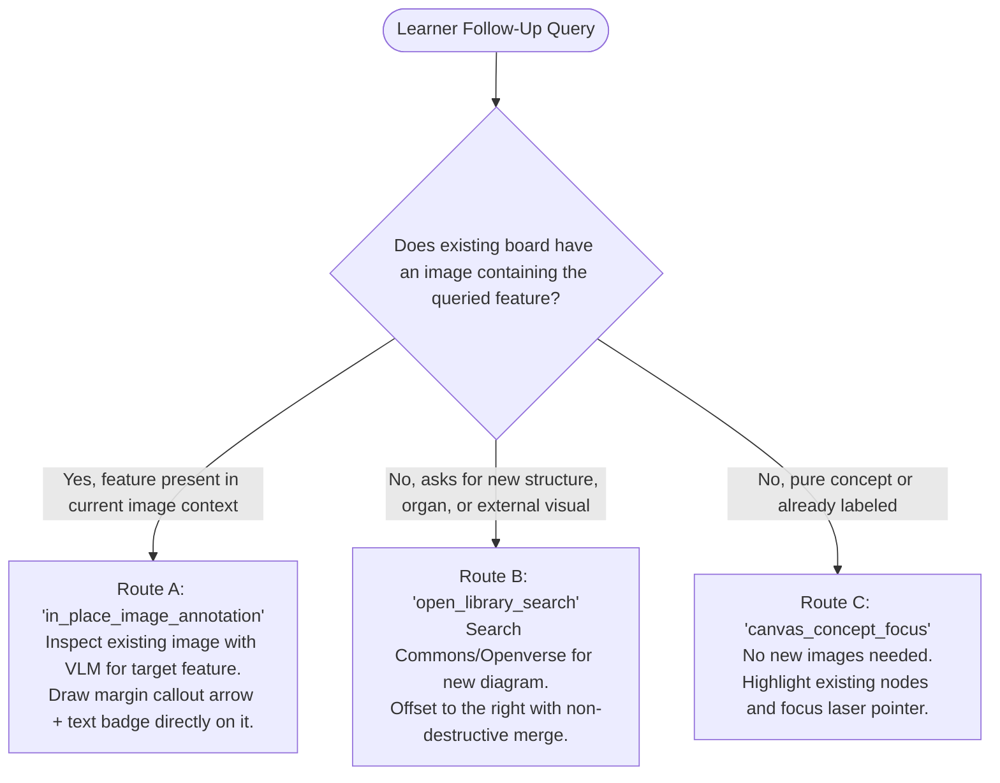
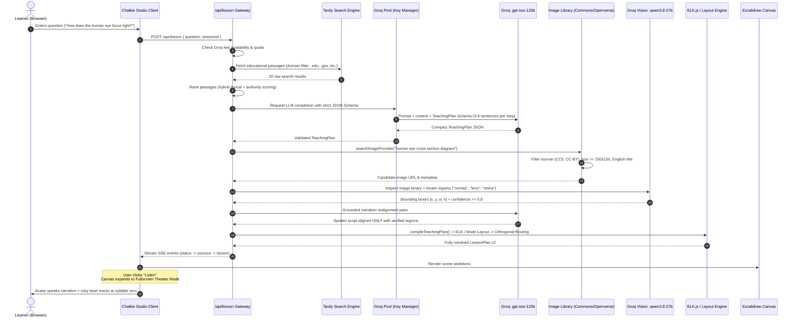
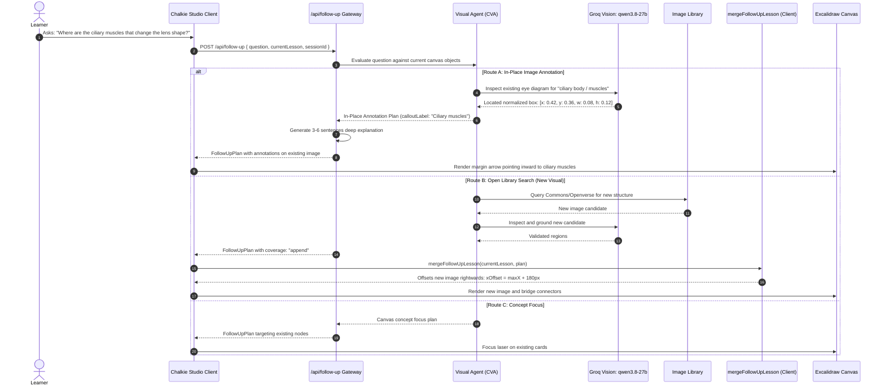

# Chalkie 2.0 — Architecture, Decision Systems, Tools & Complete Specification

> **The Definitive Engineering Bible for Chalkie 2.0.**  
> This document provides an exhaustive, granular breakdown of how Chalkie 2.0 works: its cognitive decisions, complete tool inventory, deterministic layout algorithms, vision grounding pipeline, visual agent routing, failover mechanics, audio-visual alignment, and dataflow lifecycle.

---

## Table of Contents
1. [Executive Overview & First Principles](#1-executive-overview--first-principles)
2. [Complete Tool & Subsystem Catalog (20 Subsystems)](#2-complete-tool--subsystem-catalog-20-subsystems)
3. [Decision Systems & Decision Matrices](#3-decision-systems--decision-matrices)
   - [3.1 Pedagogical Mode Decision Matrix](#31-pedagogical-mode-decision-matrix)
   - [3.2 Visual Sourcing & Trigger Matrix](#32-visual-sourcing--trigger-matrix)
   - [3.3 Visual Agent 3-Route Decision Matrix (Routes A, B, C)](#33-visual-agent-3-route-decision-matrix-routes-a-b-c)
   - [3.4 Elimination of Shading Boxes in Favor of Precision Margin Arrows](#34-elimination-of-shading-boxes-in-favor-of-precision-margin-arrows)
   - [3.5 Image Provider & License Decision Matrix](#35-image-provider--license-decision-matrix)
   - [3.6 Vision Model Acceptance & Rejection Matrix](#36-vision-model-acceptance--rejection-matrix)
   - [3.7 Spatial Layout Engine Dispatch Matrix (ELK vs Custom)](#37-spatial-layout-engine-dispatch-matrix-elk-vs-custom)
   - [3.8 Connector Port & Orthogonal Routing Matrix](#38-connector-port--orthogonal-routing-matrix)
   - [3.9 Speech Engine & Voice Selection Matrix](#39-speech-engine--voice-selection-matrix)
4. [Master Schemas & Data Dictionaries](#4-master-schemas--data-dictionaries)
   - [4.1 Compact Pedagogical Plan: `TeachingPlan` (Deep Pedagogy Edition)](#41-compact-pedagogical-plan-teachingplan-deep-pedagogy-edition)
   - [4.2 Canonical Blackboard Scene: `LessonPlan` (v2)](#42-canonical-blackboard-scene-lessonplan-v2)
   - [4.3 Visual Asset & Grounded Region: `ImageAsset`](#43-visual-asset--grounded-region-imageasset)
   - [4.4 Visual Agent Decision Schemas (`inPlaceAnnotation`, `openLibrarySearch`, `canvasConceptFocus`)](#44-visual-agent-decision-schemas-inplaceannotation-openlibrarysearch-canvasconceptfocus)
   - [4.5 Image Annotation & Precision Callout Schemas](#45-image-annotation--precision-callout-schemas)
   - [4.6 Dense VLM Inspection Schema (`qwen/qwen3.8-27b`)](#46-dense-vlm-inspection-schema-qwenqwen38-27b)
   - [4.7 Follow-Up Expansion: `FollowUpPlan` & `FollowUpMerge`](#47-follow-up-expansion-followupplan--followupmerge)
   - [4.8 Research Citation & Excerpt: `ResearchSource`](#48-research-citation--excerpt-researchsource)
   - [4.9 Canvas Playback & Laser Tracking: `CanvasPlaybackState`](#49-canvas-playback--laser-tracking-canvasplaybackstate)
5. [End-to-End Dataflow & Workflow Sequences](#5-end-to-end-dataflow--workflow-sequences)
   - [5.1 Primary Lesson Generation Lifecycle](#51-primary-lesson-generation-lifecycle)
   - [5.2 Interactive Follow-Up via Visual Agent (Routes A, B, C)](#52-interactive-follow-up-via-visual-agent-routes-a-b-c)
   - [5.3 Error Recovery, Fallback & Self-Healing Loops](#53-error-recovery-fallback--self-healing-loops)
6. [Subsystems Deep Dive](#6-subsystems-deep-dive)
   - [6.1 Research & RAG Engine (`lib/research.ts`)](#61-research--rag-engine-libresearchts)
   - [6.2 Groq Quota Pool & Multi-Key Failover (`lib/groq-pool-core.ts`)](#62-groq-quota-pool--multi-key-failover-libgroq-pool-corets)
   - [6.3 Image Sourcing & Fetch Guard (`lib/image-providers.ts`, `lib/commons-fetch.ts`)](#63-image-sourcing--fetch-guard-libimage-providersts-libcommons-fetchts)
   - [6.4 Vision Model Inspection & Grounding (`lib/image-library.ts`)](#64-vision-model-inspection--grounding-libimage-libraryts)
   - [6.5 Visual Agent Autonomous Follow-Up Engine (`lib/visual-agent.ts`)](#65-visual-agent-autonomous-follow-up-engine-libvisual-agentts)
   - [6.6 Precision Margin Callouts & Concentric Shell Router (`lib/image-annotations.ts`)](#66-precision-margin-callouts--concentric-shell-router-libimage-annotationsts)
   - [6.7 Live Ruby Laser Pointer with Sonar Pulsing & Photon Core (`components/chalk-canvas.tsx`)](#67-live-ruby-laser-pointer-with-sonar-pulsing--photon-core-componentschalk-canvastsx)
   - [6.8 Syllable-0 Audio-Visual Alignment Engine (`lib/target-matcher.ts`)](#68-syllable-0-audio-visual-alignment-engine-libtarget-matcherts)
   - [6.9 Master Classroom Deep Pedagogy (`lib/lesson-v2.ts`, `lib/grounded-narration.ts`)](#69-master-classroom-deep-pedagogy-liblesson-v2ts-libgrounded-narrationts)
   - [6.10 Fullscreen Whiteboard Theater Mode & Translucent Glassmorphism Backdrop](#610-fullscreen-whiteboard-theater-mode--translucent-glassmorphism-backdrop)
   - [6.11 Spatial Layout & Orthogonal Routing Engine](#611-spatial-layout--orthogonal-routing-engine)
   - [6.12 Progressive Canvas Engine (`components/chalk-canvas.tsx`)](#612-progressive-canvas-engine-componentschalk-canvastsx)
   - [6.13 Dual-Engine Speech Synthesizer & Animated Avatar](#613-dual-engine-speech-synthesizer--animated-avatar)
   - [6.14 Non-Destructive Follow-Up Merger (`lib/follow-up.ts`)](#614-non-destructive-follow-up-merger-libfollow-upts)
7. [API Endpoints & Server Protocols](#7-api-endpoints--server-protocols)
8. [Concrete End-to-End Execution Traces](#8-concrete-end-to-end-execution-traces)

---

## 1. Executive Overview & First Principles

**Chalkie 2.0** is an autonomous, multimodal AI educator that teaches on an infinite whiteboard. Instead of streaming text walls into a chatbot window, Chalkie behaves like a world-class human professor:
- **Draws structured visual diagrams** on an infinite blackboard.
- **Sources authentic CC-licensed reference diagrams** from Wikimedia Commons and Openverse.
- **Inspects images with a computer vision model** to locate and highlight precise anatomical, mechanical, or physical regions in real time.
- **Teaches with deep classroom pedagogy**: Explains from first principles with zero-prior-knowledge assumptions (3–6 comprehensive sentences per step, unpacking definitions, mechanisms, and real-world intuition).
- **Employs an Autonomous Visual Agent (CVA)** to route follow-up doubts through 3 distinct strategies (Route A: in-place annotation callouts on existing diagrams; Route B: open library retrieval; Route C: concept focus).
- **Points with a live ruby laser pointer** featuring a glowing white photon core and outward sonar pulsing ripples, guiding learner attention to the exact pixel.
- **Aligns audio and visuals at syllable zero** with parenthetical acronym indexing and progressive visibility filtering.
- **Expands into Fullscreen Theater Mode with a translucent glassmorphic backdrop** when the user clicks "Listen", giving the whiteboard maximum breathing room.
- **Supports seamless interactive follow-ups**, expanding upon the existing board non-destructively without erasing previous learning.

### The Core Architectural Tenets
1. **"LLMs reason pedagogically; deterministic algorithms layout spatially."**
   Language models hallucinate coordinate geometry, overlap cards, and fail at 2D packing. In Chalkie, the LLM plans cognitive relationships; algorithmic engines (`ELK.js`, orthogonal A* routing, coordinate projection math) calculate physical bounding boxes, avoid collisions, and route clean connector lines.
2. **"No visual clutter: point with arrows, never obscure with shading boxes."**
   Overlaying semi-transparent filled boxes or contour outlines over diagrams obscures underlying labels and textures. Chalkie uses external margin callout badges and precise inward-pointing arrows with zero-overlap concentric shell spacing.
3. **"Audio-visual alignment must be instantaneous."**
   Laser pointers cannot lag speech. The primary visual target anchors at syllable 0 (`charIndex === 0`), and speech synthesis cue boundaries drive the pointer smoothly across features as they are mentioned.

---

## 2. Complete Tool & Subsystem Catalog (20 Subsystems)

Chalkie 2.0 is powered by 20 dedicated internal tools and subsystems:

| # | Subsystem / Tool | Primary Source Files | Responsibility |
| :--- | :--- | :--- | :--- |
| **1** | **Research & RAG Engine** | [`lib/research.ts`](file:///c:/Users/agarw/OneDrive/Desktop/kush/chalkie%202.0/lib/research.ts)<br>[`lib/research-quality.ts`](file:///c:/Users/agarw/OneDrive/Desktop/kush/chalkie%202.0/lib/research-quality.ts)<br>[`lib/research-evidence.ts`](file:///c:/Users/agarw/OneDrive/Desktop/kush/chalkie%202.0/lib/research-evidence.ts) | Queries Tavily for educational passages, strips presentation fluff from search queries, scores source domain authority (`.edu`, `.gov`, museums), filters spam hosts, and performs hybrid lexical/semantic vector ranking. |
| **2** | **Groq Quota & Failover Pool** | [`lib/groq-pool-core.ts`](file:///c:/Users/agarw/OneDrive/Desktop/kush/chalkie%202.0/lib/groq-pool-core.ts)<br>[`lib/groq-pool.ts`](file:///c:/Users/agarw/OneDrive/Desktop/kush/chalkie%202.0/lib/groq-pool.ts)<br>[`lib/provider-credentials.ts`](file:///c:/Users/agarw/OneDrive/Desktop/kush/chalkie%202.0/lib/provider-credentials.ts) | Manages sticky API keys (`GROQ_API_KEY` & `GROQ_API_KEY_2`), tracks rate limits (TPM/RPM), schedules cooling periods, performs instant key failover upon 429 exhaustion, and intercepts JSON Schema validation errors. |
| **3** | **Pedagogical Lesson Planner (Deep Pedagogy)** | [`lib/lesson-v2.ts`](file:///c:/Users/agarw/OneDrive/Desktop/kush/chalkie%202.0/lib/lesson-v2.ts)<br>[`lib/groq.ts`](file:///c:/Users/agarw/OneDrive/Desktop/kush/chalkie%202.0/lib/groq.ts) | Executes `openai/gpt-oss-120b` under strict JSON Schema constraints. Determines teaching mode, decomposes lesson into human cognitive stages, crafts spoken narration (3–6 sentences per step, zero-prior-knowledge), and declares visual nodes and causal links. |
| **4** | **Visual Agent Autonomous Router (CVA)** | [`lib/visual-agent.ts`](file:///c:/Users/agarw/OneDrive/Desktop/kush/chalkie%202.0/lib/visual-agent.ts)<br>[`lib/visual-agent-schema.ts`](file:///c:/Users/agarw/OneDrive/Desktop/kush/chalkie%202.0/lib/visual-agent-schema.ts) | Autonomous cognitive agent that inspects learner follow-ups and selects among Route A (`in_place_image_annotation`), Route B (`open_library_search`), and Route C (`canvas_concept_focus`). |
| **5** | **Image Sourcing Provider Engine** | [`lib/image-providers.ts`](file:///c:/Users/agarw/OneDrive/Desktop/kush/chalkie%202.0/lib/image-providers.ts)<br>[`lib/commons-images.ts`](file:///c:/Users/agarw/OneDrive/Desktop/kush/chalkie%202.0/lib/commons-images.ts) | Keyless search adapter querying Wikimedia Commons MediaWiki API and Openverse REST API. Filters by license (CC0, PDM, CC BY, CC BY-SA), rejects watermarks, prioritizes English diagrams, and expands search queries if overly specific. |
| **6** | **Streaming Image Fetcher & Guard** | [`lib/commons-fetch.ts`](file:///c:/Users/agarw/OneDrive/Desktop/kush/chalkie%202.0/lib/commons-fetch.ts) | Downloads binary images, blocks unauthorized HTTP redirects (SSRF prevention), validates MIME magic bytes via `image-size`, enforces size boundaries ($\ge 150\times 150$px, $\le 12$MB), and rejects non-image payloads. |
| **7** | **Vision Grounding & Inspector** | [`lib/image-library.ts`](file:///c:/Users/agarw/OneDrive/Desktop/kush/chalkie%202.0/lib/image-library.ts)<br>[`lib/models.ts`](file:///c:/Users/agarw/OneDrive/Desktop/kush/chalkie%202.0/lib/models.ts) | Calls Groq Vision (`qwen/qwen3.8-27b`) with base64 image data. Validates educational suitability, extracts up to 8 anatomical/mechanical regions, predicts normalized 0..1 bounding boxes, and caches results for 24h. |
| **8** | **Precision Margin Callout & Arrow Compiler** | [`lib/image-annotations.ts`](file:///c:/Users/agarw/OneDrive/Desktop/kush/chalkie%202.0/lib/image-annotations.ts) | Compiles Route A annotations into Excalidraw element skeletons (`arrow` + text `badge`). Places badges in left/right canvas margins and points precise arrowheads inward to region centers, guaranteeing zero occlusion and zero overlap. |
| **9** | **Grounded Narration Realignment** | [`lib/grounded-narration.ts`](file:///c:/Users/agarw/OneDrive/Desktop/kush/chalkie%202.0/lib/grounded-narration.ts) | Secondary fast LLM pass (`openai/gpt-oss-120b`). Reconciles the teacher's verbal narration with the vision model's *actual* verified regions, ensuring the spoken script never claims unlocated parts are visible on the canvas. |
| **10** | **Syllable-0 Audio-Visual Alignment Engine** | [`lib/target-matcher.ts`](file:///c:/Users/agarw/OneDrive/Desktop/kush/chalkie%202.0/lib/target-matcher.ts) | Matches speech narration cues to canvas elements. Guarantees primary target fires at character 0, indexes parenthetical acronyms (e.g. `MECO`), strips numeric step prefixes, and filters against progressive visibility. |
| **11** | **Lesson Compiler & Namespacer** | [`lib/lesson-v2.ts`](file:///c:/Users/agarw/OneDrive/Desktop/kush/chalkie%202.0/lib/lesson-v2.ts) | Compiles intermediate `TeachingPlan` + `ImageAsset` into canonical `LessonPlan` (v2). Remaps conflicting IDs, guarantees anchor visibility, filters orphaned links, and assigns initial semantic shapes and roles. |
| **12** | **ELK Spatial Layout Engine** | [`lib/elk-spatial-layout.ts`](file:///c:/Users/agarw/OneDrive/Desktop/kush/chalkie%202.0/lib/elk-spatial-layout.ts) | Invokes Eclipse Layout Kernel (`elkjs`) for `sequence` and process flowcharts. Computes hierarchical layered DAG ranks, node ordering, port allocations, and edge crossing minimization. |
| **13** | **Mode Scene Compositor** | [`lib/teaching-layout.ts`](file:///c:/Users/agarw/OneDrive/Desktop/kush/chalkie%202.0/lib/teaching-layout.ts) | Places visual elements for `reference` (hero image + orbiting note stack), `comparison` (side-by-side dual columns with aligned row heights), and `worked-example` (numbered step stack). |
| **14** | **Orthogonal A* Obstacle Router** | [`lib/connector-routing.ts`](file:///c:/Users/agarw/OneDrive/Desktop/kush/chalkie%202.0/lib/connector-routing.ts) | Calculates orthogonal elbow connectors between card ports. Uses A* Manhattan routing with obstacle avoidance buffers to guarantee connector lines never cross through card bodies. |
| **15** | **Progressive Canvas Renderer** | [`components/chalk-canvas.tsx`](file:///c:/Users/agarw/OneDrive/Desktop/kush/chalkie%202.0/components/chalk-canvas.tsx)<br>[`lib/progressive-scene.ts`](file:///c:/Users/agarw/OneDrive/Desktop/kush/chalkie%202.0/lib/progressive-scene.ts) | Wraps Excalidraw imperative API. Maps `LessonPlan` objects into Excalidraw element skeletons (`rectangle`, `image`, `arrow`, `text`). Manages progressive disclosure (revealing only objects up to current step). |
| **16** | **Live Ruby Laser Pointer & Photon Core** | [`components/chalk-canvas.tsx`](file:///c:/Users/agarw/OneDrive/Desktop/kush/chalkie%202.0/components/chalk-canvas.tsx) | Renders a high-intensity ruby red pointer (`#ff0033`) with a white-hot photon core (`#ffffff`), concentric outward sonar rings, micro-breathing drift, and a live tracking guide pill over targeted coordinates. |
| **17** | **Dual-Engine Speech Synthesizer** | [`lib/local-speech.ts`](file:///c:/Users/agarw/OneDrive/Desktop/kush/chalkie%202.0/lib/local-speech.ts)<br>[`public/local-speech-worker.js`](file:///c:/Users/agarw/OneDrive/Desktop/kush/chalkie%202.0/public/local-speech-worker.js)<br>[`lib/voice-selection.ts`](file:///c:/Users/agarw/OneDrive/Desktop/kush/chalkie%202.0/lib/voice-selection.ts) | Dual-tier speech: Tier 1 is client-side Kokoro.js neural TTS (82M params running on CPU via ONNX in a Web Worker, zero API cost); Tier 2 is browser Web Speech API with automatic natural voice ranking. |
| **18** | **Animated Teacher Personas** | [`components/teacher-avatar.tsx`](file:///c:/Users/agarw/OneDrive/Desktop/kush/chalkie%202.0/components/teacher-avatar.tsx)<br>[`components/avatar-preview.tsx`](file:///c:/Users/agarw/OneDrive/Desktop/kush/chalkie%202.0/components/avatar-preview.tsx) | SVG teacher personas (**Mira** and **Arjun**). Features state-machine driven natural eye blinks, breathing animations, speech tempo mouth approximations, and arm gestures tracking the laser pointer. |
| **19** | **Follow-Up Scene Merger & Extender** | [`lib/follow-up.ts`](file:///c:/Users/agarw/OneDrive/Desktop/kush/chalkie%202.0/lib/follow-up.ts) | Merges follow-up plans into the active lesson non-destructively: namespaces IDs, offsets coordinates rightwards ($x_{\text{offset}} = \max(x_{\text{existing}} + w_{\text{existing}}) + 180\text{px}$), translates internal connection waypoints, routes cross-connectors, and aligns step playback. |
| **20** | **Fullscreen Theater Mode & Glassmorphic Classroom** | [`components/chalkie-studio.tsx`](file:///c:/Users/agarw/OneDrive/Desktop/kush/chalkie%202.0/components/chalkie-studio.tsx)<br>[`app/chalkie.css`](file:///c:/Users/agarw/OneDrive/Desktop/kush/chalkie%202.0/app/chalkie.css) | Expands the whiteboard into an expansive presentation canvas upon clicking "Listen", displaying a translucent glassmorphic blur backdrop (`backdrop-filter: blur(14px)`), floating narration bar with avatar, and step navigation. |

---

## 3. Decision Systems & Decision Matrices

### 3.1 Pedagogical Mode Decision Matrix
The LLM evaluates the learner's query against five teaching methodologies:


---

### 3.2 Visual Sourcing & Trigger Matrix
Chalkie decides whether to query image libraries based on two distinct triggers:
1. **Explicit Visual Triggers**:
   If the prompt contains words like *"visually"*, *"show me"*, *"diagram"*, *"stages visually"*, *"draw"*, *"picture"*, or *"chart"*, visual image nodes are **mandated**.
2. **Proactive Visual Triggers**:
   Even if the user does *not* explicitly ask for a picture, Chalkie evaluates the physical vs. abstract nature:
   - **Physical / Spatial Topics** (rockets, engines, human organs, plants, planetary bodies, hardware, optical systems) $\longrightarrow$ **Proactively include 1 to 3 image nodes**.
   - **Pure Abstract Topics** (formal logic, epistemological philosophy, algorithmic complexity, grammatical rules) $\longrightarrow$ **Rely on geometric cards (`box`, `text`) without images**.

---

### 3.3 Visual Agent 3-Route Decision Matrix (Routes A, B, C)
When a learner asks a doubt on an existing lesson, the Visual Agent (`lib/visual-agent.ts`) executes a cognitive dispatch:



- **Route A (`in_place_image_annotation`)**:
  - The feature is part of an object already on screen (e.g. *"Where is the pupil and lens?"* when an eye diagram is on screen).
  - Keeps the board clean by reusing the existing diagram instead of fetching duplicate images.
  - VLM pinpoints the feature coordinates; Chalkie generates margin callouts pointing into the existing diagram.
- **Route B (`open_library_search`)**:
  - The feature is an entirely separate anatomical or mechanical entity (e.g. *"Show me the nephron inside the kidney"*).
  - Fetches a dedicated high-resolution diagram from Wikimedia Commons / Openverse and appends it to the right.
- **Route C (`canvas_concept_focus`)**:
  - The doubt is conceptual (e.g. *"Why is blood red?"* or *"What is the pressure difference?"*).
  - Explains verbally while pointing the laser pointer at the relevant existing chambers or text nodes.

---

### 3.4 Elimination of Shading Boxes in Favor of Precision Margin Arrows
In earlier prototypes, Chalkie experimented with drawing semi-transparent colored rectangles or contour bounding boxes over image regions. In practice:
- Semi-transparent boxes darkened and blurred fine diagram labels underneath.
- Rectangular boxes gave a false impression of feature boundaries.
- Overlapping boxes produced muddy, illegible squares on complex diagrams.

**Chalkie 2.0 Architectural Rule**:
> **Shading and contour boxes are completely abolished.**
> Image features are annotated strictly via **Precision Margin Callouts**:
> 1. An elegant text badge (`#fef3c7`, font size 18px) placed in the outer margin of the image.
> 2. A clean directional arrow originating from the badge margin and terminating precisely at the detected feature coordinates.
> 3. Zero obstruction of the diagram interior; 100% visual legibility.

---

### 3.5 Image Provider & License Decision Matrix
Implemented in [`lib/image-providers.ts`](file:///c:/Users/agarw/OneDrive/Desktop/kush/chalkie%202.0/lib/image-providers.ts):
- **Wikimedia Commons** queried first via MediaWiki API.
- If no suitable candidate is found, falls back automatically to **Openverse REST API**.
- Strictly enforces free commercial reuse licenses: `["cc0", "pdm", "by", "by-sa"]`. Rejects `nc` (non-commercial) and `nd` (no derivatives).
- Dimensions must satisfy $\text{width} \ge 250\text{px}$ and $\text{height} \ge 150\text{px}$.
- Sorts English diagram candidates (`\benglish\b|[-_]en[.\s_-]`) first.

---

### 3.6 Vision Model Acceptance & Rejection Matrix
Implemented in [`lib/image-library.ts`](file:///c:/Users/agarw/OneDrive/Desktop/kush/chalkie%202.0/lib/image-library.ts) via `qwen/qwen3.8-27b`:

| Criteria | Vision Model Decision | Chalkie System Action |
| :--- | :--- | :--- |
| **High-quality educational diagram, cross-section, or scientific photo with English or Latin nomenclature** | `suitable: true` | Model detects bounding boxes for up to 8 regions. System attaches `ImageAsset` to the visual node. |
| **Predominantly labeled in non-Latin scripts (Cyrillic, Chinese, Arabic) or full foreign language paragraphs** | `suitable: false` | System rejects candidate. Moves to next candidate in iterator. If all fail, silently falls back to `shapeType = "note"`. |
| **Heavily watermarked, blurry, low-resolution ($<150\text{px}$), or misleading diagram** | `suitable: false` | Image is rejected. |
| **Region confidence score $< 0.8$ or region extends beyond $[0, 0, 1, 1]$** | Discarded region | Region is omitted. Only verified regions ($\ge 0.8$ confidence) are passed to the narration grounding engine. |

---

### 3.7 Spatial Layout Engine Dispatch Matrix (ELK vs Custom)
Chalkie chooses its layout engine deterministically based on `teachingMode`:
- `sequence` or branching processes $\longrightarrow$ **ELK.js** (`lib/elk-spatial-layout.ts`) hierarchical layered DAG layout.
- `reference` $\longrightarrow$ **Mode Scene Compositor** (`lib/teaching-layout.ts`): Hero image at `(64, 112)`, notes orbiting on the right.
- `comparison` $\longrightarrow$ **Dual-Column Grid**: Side-by-side columns with synchronized row heights.
- `worked-example` $\longrightarrow$ **Vertical Indented Stack** (`width: 720px`).
- `concept` $\longrightarrow$ Primary subject headline with satellite explanatory cards.

---

### 3.8 Connector Port & Orthogonal Routing Matrix
Implemented in [`lib/connector-routing.ts`](file:///c:/Users/agarw/OneDrive/Desktop/kush/chalkie%202.0/lib/connector-routing.ts):
1. Calculates port direction based on major axis:
   $$\Delta x = x_{\text{to}} - x_{\text{from}},\quad \Delta y = y_{\text{to}} - y_{\text{from}}$$
2. Bounding boxes of all non-endpoint cards are inflated by $24\text{px}$ as obstacles.
3. An A* orthogonal grid pathfinder generates clean 90-degree elbow waypoints routing *around* card hulls without intersecting any card body.

---

### 3.9 Speech Engine & Voice Selection Matrix
- **Local Natural Speech** (Tier 1, Recommended): Kokoro.js neural TTS (82M params running on CPU via ONNX in a Web Worker, zero API cost).
  - **Mira**: `af_heart` / `af_bella`
  - **Arjun**: `am_adam` / `am_michael`
- **Device Speech** (Tier 2): Browser Web Speech API (`window.speechSynthesis`).
  - Auto-selects highest-fidelity voices matching `natural|neural|online`. Filters out robotic legacy synths.

---

## 4. Master Schemas & Data Dictionaries

### 4.1 Compact Pedagogical Plan: `TeachingPlan` (Deep Pedagogy Edition)
Defined in [`lib/lesson-v2.ts`](file:///c:/Users/agarw/OneDrive/Desktop/kush/chalkie%202.0/lib/lesson-v2.ts).

```typescript
export const teachingModes = ["reference", "sequence", "comparison", "worked-example", "concept"] as const;

export type TeachingPlan = {
  title: string;           // Concise headline (max 120 chars)
  summary: string;         // Conceptual takeaway (max 600 chars)
  teachingMode?: "reference" | "sequence" | "comparison" | "worked-example" | "concept";
  coverage: "existing" | "append"; // Canvas mutation strategy
  
  // Up to 12 visual cards per lesson
  nodes: Array<{
    id: string;            // Slug: /^[a-zA-Z0-9_-]{1,56}$/
    label: string;         // Whiteboard card headline (1-12 words, max 120 chars)
    kind: "box" | "ellipse" | "text" | "image";
    column?: "left" | "right" | "full"; // Active in comparison mode
    imageQuery: string;    // 2-4 search keywords (empty string if not an image, max 160 chars)
    regions: string[];     // Up to 12 anatomical/mechanical labels to locate
  }>;
  
  // Up to 18 causal links
  links: Array<{
    from: string;          // Source node ID
    to: string;            // Target node ID
    label: string;         // Action/relationship verb (1-4 words, max 60 chars)
  }>;
  
  // Up to 8 spoken pedagogical steps
  steps: Array<{
    title: string;         // Micro-headline naming the specific event (max 80 chars)
    narration: string;     // Deep explanation: 3-6 comprehensive sentences (max 2000 chars)
    targetIds: string[];   // Up to 12 visual element IDs or region anchors (#label)
  }>;
};
```

> **Deep Pedagogy Enforcement**:
> In [`lib/lesson-v2.ts`](file:///c:/Users/agarw/OneDrive/Desktop/kush/chalkie%202.0/lib/lesson-v2.ts), the prompt mandates **3 to 6 comprehensive sentences per step**:
> - Explain like an inspiring classroom professor.
> - Assume zero prior domain knowledge: clearly define every technical term.
> - Detail the physical mechanisms and causality (why and how things happen).
> - Token budget expanded to `max_completion_tokens: 4500` with narration length up to 2000 characters.

---

### 4.2 Canonical Blackboard Scene: `LessonPlan` (v2)
Defined in [`lib/lesson-schema.ts`](file:///c:/Users/agarw/OneDrive/Desktop/kush/chalkie%202.0/lib/lesson-schema.ts).

```typescript
export type LessonPlan = {
  version?: 2;
  id: string;              // e.g. "lesson-1718000000000"
  title: string;
  question: string;        // Original user query
  summary: string;
  teachingMode?: "reference" | "sequence" | "comparison" | "worked-example" | "concept";
  diagramType: "mechanism" | "spatial" | "structure" | "cycle" | "process" | "comparison" | "timeline" | "system" | "quantitative";
  visualStrategy: string;
  sources: ResearchSource[];
  objects: VisualObject[];     // All rendered visual elements (cards, notes, images)
  connections: VisualConnection[]; // Routed connector lines
  segments: LessonSegment[];   // Chronological playback steps
};

export type VisualObject = {
  id: string;
  parentId?: string;
  role: "subject" | "component" | "environment" | "container" | "input" | "output" | "force" | "annotation" | "energy" | "motion" | "field" | "path" | "layer" | "formula";
  shapeType: "custom" | "custom-chart" | "custom-svg" | "custom-template" | "geo" | "note" | "frame" | "image";
  geo?: string;
  color?: CanvasColor;
  label: string;
  labelPlacement: "inside" | "below" | "above" | "left" | "right" | "none";
  x: number;               // Absolute 2D board coordinate
  y: number;               // Absolute 2D board coordinate
  width: number;           // Card width in pixels
  height: number;          // Card height in pixels
  comparisonSide?: "left" | "right" | "full";
  parts?: VisualPart[];
  image?: ImageAsset;
  imageRequest?: {
    query: string;
    status: "ready" | "not_found" | "rejected" | "unavailable";
  };
};

export type LessonSegment = {
  id: string;              // e.g. "step-0"
  title: string;           // Headline shown in UI step guide
  narration: string;       // Spoken text
  targetIds: string[];     // Highlighted targets (e.g. ["heart-img", "heart-img#aorta", "heart-img#0"])
  action: "reveal" | "focus" | "trace" | "move" | "rotate" | "pulse" | "flow" | "orbit";
  durationMs: number;      // Estimated speech duration in ms
};
```

---

### 4.3 Visual Asset & Grounded Region: `ImageAsset`
Defined in [`lib/lesson-schema.ts`](file:///c:/Users/agarw/OneDrive/Desktop/kush/chalkie%202.0/lib/lesson-schema.ts) & [`lib/image-library.ts`](file:///c:/Users/agarw/OneDrive/Desktop/kush/chalkie%202.0/lib/image-library.ts).

```typescript
export type ImageRegion = {
  label: string;           // Anatomical/mechanical part (e.g. "left ventricle")
  x: number;               // Normalized X origin (0.0 to 1.0, top-left)
  y: number;               // Normalized Y origin (0.0 to 1.0, top-left)
  width: number;           // Normalized width (0.0 to 1.0)
  height: number;          // Normalized height (0.0 to 1.0)
  confidence: number;      // Vision model confidence threshold (>= 0.8)
};

export type ImageAsset = {
  id: string;
  title: string;
  url: string;
  sourceUrl: string;
  author: string;
  license: string;
  licenseUrl: string;
  width: number;
  height: number;
  description?: string;
  regions: ImageRegion[];
};
```

---

### 4.4 Visual Agent Decision Schemas (`inPlaceAnnotation`, `openLibrarySearch`, `canvasConceptFocus`)
Defined in [`lib/visual-agent-schema.ts`](file:///c:/Users/agarw/OneDrive/Desktop/kush/chalkie%202.0/lib/visual-agent-schema.ts).

```typescript
// Route A: In-place callout on existing image
export const inPlaceAnnotationPlanSchema = z.object({
  action: z.literal("in_place_image_annotation"),
  rationale: z.string().max(300),
  targetImageId: z.string().max(60),
  targetFeatureQuery: z.string().min(1).max(120),
  shadingColor: z.enum(["amber", "violet", "cyan", "yellow", "emerald"]).default("amber"),
  drawStyle: z.literal("full_annotation"),
  calloutLabel: z.string().max(40),
});

// Route B: Fetch new image asset and append
export const openLibrarySearchPlanSchema = z.object({
  action: z.literal("open_library_search"),
  rationale: z.string().max(300),
  imageQuery: z.string().min(3).max(120),
  regionsToLocate: z.array(z.string().min(1).max(80)).min(1).max(8),
  teachingMode: z.enum(["reference", "sequence", "comparison", "worked-example", "concept"]).default("reference"),
});

// Route C: Reusing board cards / laser focus
export const canvasConceptFocusPlanSchema = z.object({
  action: z.literal("canvas_concept_focus"),
  rationale: z.string().max(300),
  targetObjectIds: z.array(z.string().max(60)).min(1).max(6),
});

// Discriminated Union
export const visualAgentDecisionSchema = z.discriminatedUnion("action", [
  inPlaceAnnotationPlanSchema,
  openLibrarySearchPlanSchema,
  canvasConceptFocusPlanSchema,
]);
export type VisualAgentDecision = z.infer<typeof visualAgentDecisionSchema>;
```

---

### 4.5 Image Annotation & Precision Callout Schemas
Defined in [`lib/visual-agent-schema.ts`](file:///c:/Users/agarw/OneDrive/Desktop/kush/chalkie%202.0/lib/visual-agent-schema.ts) and [`lib/image-annotations.ts`](file:///c:/Users/agarw/OneDrive/Desktop/kush/chalkie%202.0/lib/image-annotations.ts).

```typescript
export const normalizedRegionBoxSchema = z.object({
  x: z.number().finite().min(0).max(1),
  y: z.number().finite().min(0).max(1),
  width: z.number().finite().min(0).max(1),
  height: z.number().finite().min(0).max(1),
});

export const imageAnnotationSchema = z.object({
  id: z.string().regex(/^[a-zA-Z0-9_-]{1,56}$/),
  targetImageId: z.string(),
  regionLabel: z.string().min(1).max(80),
  normalized: normalizedRegionBoxSchema,
  color: z.enum(["amber", "violet", "cyan", "yellow", "emerald"]).default("amber"),
  drawStyle: z.literal("full_annotation"),
  calloutText: z.string().max(80).optional(),
  stepIndex: z.number().optional(),
});
export type ImageAnnotation = z.infer<typeof imageAnnotationSchema>;
```

---

### 4.6 Dense VLM Inspection Schema (`qwen/qwen3.8-27b`)
Defined in [`lib/visual-agent-schema.ts`](file:///c:/Users/agarw/OneDrive/Desktop/kush/chalkie%202.0/lib/visual-agent-schema.ts).

```typescript
export const denseRegionSchema = z.object({
  label: z.string(),
  x: z.number().min(0).max(1),
  y: z.number().min(0).max(1),
  width: z.number().min(0).max(1),
  height: z.number().min(0).max(1),
  confidence: z.number().min(0).max(1),
});

export const denseVLMInspectionSchema = z.object({
  suitable: z.boolean(),
  description: z.string().max(600),
  regions: z.array(denseRegionSchema).max(8),
});
export type DenseVLMInspection = z.infer<typeof denseVLMInspectionSchema>;
```

---

### 4.7 Follow-Up Expansion: `FollowUpPlan` & `FollowUpMerge`
Defined in [`lib/lesson-schema.ts`](file:///c:/Users/agarw/OneDrive/Desktop/kush/chalkie%202.0/lib/lesson-schema.ts) & [`lib/follow-up.ts`](file:///c:/Users/agarw/OneDrive/Desktop/kush/chalkie%202.0/lib/follow-up.ts).

```typescript
export type FollowUpPlan = {
  id: string;              // e.g. "follow-up-1718000000000"
  teachingMode?: "reference" | "sequence" | "comparison" | "worked-example" | "concept";
  title: string;           // Follow-up topic title
  answer: string;          // Direct verbal explanation of the doubt
  coverage: "existing" | "append"; // Mutation mode
  visualStrategy: string;
  targetIds: string[];     // Targeted visual IDs on board
  objects: VisualObject[]; // New visual cards/images (empty when coverage === "existing")
  connections: VisualConnection[]; // Routed connections (internal and cross-links)
  segments: LessonSegment[]; // New pedagogical narration segments (1-6 steps)
  sources?: ResearchSource[]; // Reused or updated research citations
};

export type FollowUpMerge = {
  lesson: LessonPlan;      // Unified, expanded lesson plan with new objects and segments
  startIndex: number;      // Index where follow-up segments begin
  newObjectIds: string[];  // List of freshly added object IDs
};
```

---

### 4.8 Research Citation & Excerpt: `ResearchSource`
Defined in [`lib/lesson-schema.ts`](file:///c:/Users/agarw/OneDrive/Desktop/kush/chalkie%202.0/lib/lesson-schema.ts).

```typescript
export type ResearchSource = {
  id: string;
  title: string;
  url: string;
  publisher: string;       // e.g. "NIH/NLM", "NASA", "Britannica"
  summary: string;         // Distilled factual excerpt
  score: number;           // Relevance score (0.0 to 1.0)
};
```

---

### 4.9 Canvas Playback & Laser Tracking: `CanvasPlaybackState`
Defined in [`lib/playback-sync.ts`](file:///c:/Users/agarw/OneDrive/Desktop/kush/chalkie%202.0/lib/playback-sync.ts) and [`lib/image-coordinates.ts`](file:///c:/Users/agarw/OneDrive/Desktop/kush/chalkie%202.0/lib/image-coordinates.ts).

```typescript
export type CanvasPlaybackState =
  | { status: "loading"; request: number }
  | { status: "ready"; request: number }
  | { status: "error"; request: number; message: string };

export type NarrationCue = {
  charIndex: number;
  targetId: string;
};
```

---

## 5. End-to-End Dataflow & Workflow Sequences

### 5.1 Primary Lesson Generation Lifecycle



---

### 5.2 Interactive Follow-Up via Visual Agent (Routes A, B, C)



---

### 5.3 Error Recovery, Fallback & Self-Healing Loops
1. **Groq HTTP 429 (Rate Limit Exhaustion)**:
   - `lib/groq-pool-core.ts` detects 429 response.
   - Marks current key as `cooldown` with reset timestamp.
   - Automatically switches to `GROQ_API_KEY_2` and retries without user interruption.
2. **Groq HTTP 400 (JSON Schema Violation)**:
   - `lib/groq.ts` intercepts `GroqHttpError`.
   - Parses `error.body` to extract the exact property path.
   - Re-injects the violation message into the prompt on attempt 2, enabling the model to self-correct.
3. **Image Fetch or Vision Rejection**:
   - If Commons/Openverse is unreachable, returns HTTP 404, or the image is rejected by `qwen3.8-27b`, Chalkie silently sets `node.shapeType = "note"`.
   - Gracefully degrades into a handwritten chalk note card, and the lesson proceeds uninterrupted.
4. **Tavily Research Failure**:
   - If Tavily returns empty results or keys are invalid, Chalkie halts with a clear `ResearchError` rather than hallucinating unsourced facts.

---

## 6. Subsystems Deep Dive

### 6.1 Research & RAG Engine (`lib/research.ts`)
- **Query Hygiene**: `researchQuery()` extracts clean factual subject terms, stripping UI directives like *"include pictures"*, *"draw"*, or *"show me"*.
- **Domain Scoring**: `sourceAuthority()` scores `.edu`, `.gov`, `.ac.uk`, and known scientific domains (`nature.com`, `britannica.com`, `nasa.gov`) with a $+0.2$ boost.
- **Spam Filtering**: Automatically rejects commercial stock image sites (`shutterstock`, `gettyimages`, `pinterest`) and crowd-sourced homework dumps (`brainly`).
- **Hybrid Scoring**: Combines logarithmic term frequency lexical scoring with optional dense semantic vector embeddings.

---

### 6.2 Groq Quota Pool & Multi-Key Failover (`lib/groq-pool-core.ts`)
- Manages key pools in memory across concurrent requests.
- Tracks `remainingRequests`, `remainingTokens`, and `resetTime` from HTTP response headers (`x-ratelimit-*`).
- If an API key hits rate limits, it enters a `cooldown` state until its reset duration elapses, automatically routing traffic to secondary credentials.

---

### 6.3 Image Sourcing & Fetch Guard (`lib/image-providers.ts`, `lib/commons-fetch.ts`)
- Implements a generator `imageCandidates(query)` that streams candidate references one-by-one.
- Fetches image headers first; blocks HTTP redirects to untrusted domains.
- Verifies binary buffer magic bytes using `image-size` (supports SVG, PNG, JPEG, WebP).

---

### 6.4 Vision Model Inspection & Grounding (`lib/image-library.ts`)
- Dispatches a multi-part chat completion to `qwen/qwen3.8-27b`:
  - Part 1: Educational inspection prompt instructing the model to locate parts, check language scripts, and reject non-educational media.
  - Part 2: Base64-encoded image data URL.
- Parses returned JSON bounding boxes, enforces normalization invariants ($x + w \le 1.001$, $y + h \le 1.001$), filters confidence $\ge 0.8$, and slices to top 8 validated regions.

---

### 6.5 Visual Agent Autonomous Follow-Up Engine (`lib/visual-agent.ts`)
- When a user asks a follow-up doubt, `planVisualAgentFollowUp()` evaluates the doubt against the active board inventory.
- Inspects whether an existing `image` object depicts the organ/system in question.
- If an image exists, dispatches Groq Vision with the specific sub-component query (e.g. *"locate ciliary body or zonules on this eye diagram"*).
- If located with confidence $\ge 0.75$, outputs **Route A** (`in_place_image_annotation`).
- If not visible or query requires a new system, outputs **Route B** (`open_library_search`) or **Route C** (`canvas_concept_focus`).

---

### 6.6 Precision Margin Callouts & Concentric Shell Router (`lib/image-annotations.ts`)
- **Zero-Occlusion Margin Partitioning**:
  - Labels partition into left-margin ($normCenterX \le 0.65$) and right-margin ($normCenterX > 0.65$) clusters.
  - For centered or concentric circular features (e.g., eye pupil/lens, earth core), preferentially selects the **left margin** to avoid intersecting outgoing rightward diagram arrows.
- **Vertical Anti-Crossing Staggering**:
  - Sorts callouts along each margin by vertical center coordinates:
    $$\text{slotSpacing} = 44\text{px}$$
  - For concentric features sharing the same vertical midpoint, sorts outer shells to the top and inner cores below, guaranteeing callout arrows are parallel and **never cross each other**.
- **Concentric Shell Boundary Targeting**:
  - For wide structures ($width \ge 0.22$), the arrow body originates in the outer margin beside the text badge and targets the outer margin boundary of the shell rather than the dead center, making it crystal-clear which ring or layer is being identified.

---

### 6.7 Live Ruby Laser Pointer with Sonar Pulsing & Photon Core (`components/chalk-canvas.tsx`)
Rendered directly in SVG over Excalidraw's canvas viewport:
- **High-Intensity Ruby Core**: `#ff0033` with an SVG drop shadow glow filter (`#ff1744` and `#ff0033`).
- **White-Hot Photon Tip**: `#ffffff` center dot (radius 2.2px) marking the exact focal point.
- **Concentric Sonar Rings**:
  - Outer ring: $r \in [4, 22]\text{px}$, opacity $0.85 \to 0.05$, duration $1.8\text{s}$.
  - Inner ring: $r \in [3, 13]\text{px}$, opacity $0.9 \to 0.15$, duration $1.8\text{s}$.
- **Organic Micro-Breathing Drift**:
  $$x_{\text{dest}} = x_{\text{screen}} + 0.6\sin(1.6 t),\quad y_{\text{dest}} = y_{\text{screen}} + 0.5\cos(1.9 t)$$
  Smooth damping ($dx \times 0.25$) ensures lifelike pointer motion.
- **Target Tracking Pill**: Floating pill badge beside the pointer tip displaying the active target label (`activeSegment.title` or `regionBadge`).

---

### 6.8 Syllable-0 Audio-Visual Alignment Engine (`lib/target-matcher.ts`)
- **Zero-Drift Syllable-0 Anchoring**:
  The primary visual target of each pedagogical step is anchored at `charIndex === 0`. The instant the teacher begins speaking, the laser pointer is already locked on the first element.
- **Parenthetical Acronym Indexing**:
  Phrases like *"Main Engine Cutoff (MECO)"* or *"Adenosine Triphosphate (ATP)"* register both the full phrase and acronym keywords (`MECO`, `ATP`) to prevent misses during spoken narration.
- **Numeric Prefix Stripping**:
  Strips prefixes like `"1. "`, `"Step 2: "` so numbering never disrupts keyword matching.
- **Progressive Visibility Filter**:
  Restricts target searching to objects currently visible at that step, preventing the laser from jumping to unrevealed future cards.

---

### 6.9 Master Classroom Deep Pedagogy (`lib/lesson-v2.ts`, `lib/grounded-narration.ts`)
- **3 to 6 Comprehensive Sentences per Step**:
  Step narrations provide thorough, university-grade instruction instead of surface summaries.
- **Zero-Prior-Knowledge Assumption**:
  Unpacks every technical term, mechanism, and physical cause-and-effect relationship.
- **Model Configuration**:
  - `max_completion_tokens: 4500`
  - Narration character limits expanded to 2000 characters.

---

### 6.10 Fullscreen Whiteboard Theater Mode & Translucent Glassmorphism Backdrop
Implemented in [`components/chalkie-studio.tsx`](file:///c:/Users/agarw/OneDrive/Desktop/kush/chalkie%202.0/components/chalkie-studio.tsx) and [`app/chalkie.css`](file:///c:/Users/agarw/OneDrive/Desktop/kush/chalkie%202.0/app/chalkie.css):
- **Automatic Expansion on "Listen"**:
  Clicking "Listen" or selecting any step automatically sets `isTheaterMode = true`.
- **Viewport Dimensioning**:
  The canvas panel breaks out into `position: fixed; top: 12px; bottom: 12px; left: 12px; right: 12px; border-radius: 20px; z-index: 1000`.
- **Translucent Glassmorphic Backdrop (`.studio-theater-backdrop`)**:
  - `position: fixed; inset: 0; z-index: 990;`
  - `background: rgba(10, 11, 15, 0.78); backdrop-filter: blur(14px);`
  - Clicking the blurred outer margin or pressing **Escape** exits theater mode.
- **Floating Narration & Avatar Card (`.studio-theater-narration`)**:
  - Positioned floating at the bottom center (`bottom: 24px; left: 50%; transform: translateX(-50%)`).
  - Frosted glassmorphism background (`rgba(27, 29, 36, 0.9); backdrop-filter: blur(16px)`).
  - Displays speaking teacher avatar alongside synchronized subtitles.
- **Automatic Camera Centering**:
  Window resize listeners in [`components/chalk-canvas.tsx`](file:///c:/Users/agarw/OneDrive/Desktop/kush/chalkie%202.0/components/chalk-canvas.tsx) re-trigger `scrollToContent` with `fitToContent: true` so the entire diagram scales to the enlarged display.

---

### 6.11 Spatial Layout & Orthogonal Routing Engine
- **ELK.js Integration**: Constructs an `ElkNode` hierarchy, assigns port constraints, and invokes `elk.layout()`.
- **A* Orthogonal Router**: Computes obstacle bounding boxes with safety margins, searches Manhattan grid steps, and outputs clean 90-degree elbow waypoints.

---

### 6.12 Progressive Canvas Engine (`components/chalk-canvas.tsx`)
- Maps Chalkie's abstract `LessonPlan` objects into Excalidraw element primitives.
- Renders custom chalkboard styling: roughness `1`, stroke width `2`, dark blackboard background `#121212`, violet chalk highlight `#a78bfa`.
- Updates camera viewport smoothly when changing steps, avoiding jarring camera snaps.

---

### 6.13 Dual-Engine Speech Synthesizer & Animated Avatar
- **Kokoro.js Web Worker**: Spawns `public/local-speech-worker.js`. Streams raw PCM float arrays into browser `AudioContext`.
- **Avatar State Machine**:
  - `isSpeaking`: drives mouth open/close cycle.
  - `blinkTimer`: triggers realistic eyelid drop every 3.5 to 6 seconds.
  - `pointing`: drives arm gesture pointing toward active card or region target.

---

### 6.14 Non-Destructive Follow-Up Merger (`lib/follow-up.ts`)
- **Non-Destructive Scene Extension**: Preserves the existing scene graph and all previously rendered visual coordinates without shift or jitter.
- **Collision-Proof ID Remapping**: Generates safe, scoped identifiers (`follow-${safeId(plan.id)}-object-${index}`) to prevent collision with previously placed objects.
- **Rightward Displacement**: Offsets new elements horizontally past the existing board boundary:
  $$x_{\text{offset}} = \max(x_{\text{current}} + \text{width}_{\text{current}}) + 180\text{px} - \min(x_{\text{new}})$$
  $$y_{\text{offset}} = \min(y_{\text{current}}) - \min(y_{\text{new}})$$
- **Obstacle-Avoiding Cross-Connectors**: Resolves bridge connections linking old visual cards to new cards using `automaticAnchors` and `routeOrthogonalConnector` (A* Manhattan algorithm avoiding card hulls).
- **Playback Continuation**: Appends follow-up steps into `segments` starting from `startIndex = current.segments.length`, setting camera framing to reveal new material smoothly.

---

## 7. API Endpoints & Server Protocols

| Endpoint | Method | Request Payload | Response Type | Description |
| :--- | :--- | :--- | :--- | :--- |
| `/api/lesson` | `POST` | `{ question: string, sessionId?: string, preferredGroqKeyId?: string, useWeb: true }` | Server-Sent Events (`text/event-stream`) | Primary generation endpoint. Emits status stages, retrieved sources, quota snapshots, and final compiled `LessonPlan`. |
| `/api/follow-up` | `POST` | `{ question: string, currentLesson: LessonPlan, sessionId: string, preferredGroqKeyId?: string }` | Server-Sent Events (`text/event-stream`) | Follow-up endpoint. Evaluates Visual Agent dispatch (Routes A, B, C) and emits `decision`, `sketch`, and `followup` (`{ plan: FollowUpPlan }`). Client merges into canvas via `mergeFollowUpLesson`. |
| `/api/image` | `GET` | `?url=https://upload.wikimedia.org/...` | Binary Image Stream | Validated image proxy. Prevents CORS failures and canvas tainting. |
| `/api/health` | `GET` | *none* | `application/json` | Health check probe. Returns server status and key configuration. |

---

## 8. Concrete End-to-End Execution Traces

### Trace 1: Primary Lesson Generation
**Query**: *"Explain how the human eye focuses light."*
1. **Research Retrieval**: Tavily retrieves medical literature on the cornea, lens accommodation, ciliary muscle contraction, and retina phototransduction.
2. **Groq Lesson Plan (`gpt-oss-120b`)**:
   - `teachingMode: "reference"`
   - `nodes`: Hero image (`human eye anatomy diagram cross section`) + 3 explanatory mechanism cards.
   - `steps`: 4 master steps (3–5 sentences each) explaining refraction, accommodation, and signal transduction.
3. **Commons Search & VLM Inspection (`qwen3.8-27b`)**:
   - Downloads `Eyesection-en.svg` (CC BY-SA 3.0).
   - VLM validates suitability and identifies regions: `cornea`, `lens`, `retina`, `optic nerve`.
4. **Layout & Compilation**:
   - Places hero image at `(64, 112, 540, 420)`.
   - Stacks analytical cards on the right at `x = 684`.
5. **Presentation**:
   - User clicks **"Listen"**.
   - Whiteboard enlarges to **Fullscreen Theater Mode** with a translucent glassmorphism backdrop (`blur(14px)`).
   - Syllable-0 anchor locks the ruby laser pointer with outward sonar rings directly on the cornea as narration begins.

---

### Trace 2: Visual Agent Route A Follow-Up
**Follow-Up Query**: *"Where are the ciliary muscles that adjust the lens?"*
1. **Visual Agent Evaluation**:
   - Evaluates active board: contains hero image `eye-anatomy-diagram` with native resolution $540\times 420$.
   - Selects **Route A** (`in_place_image_annotation`).
2. **VLM Inspection for Specific Sub-Component**:
   - Calls `qwen3.8-27b` with query `"locate ciliary body or ciliary muscles"`.
   - VLM identifies region: `{ x: 0.40, y: 0.32, width: 0.08, height: 0.14, confidence: 0.91 }`.
3. **Precision Margin Callout**:
   - `compileImageAnnotationSkeletons` places text badge `"Ciliary muscles"` in the outer left margin at `x = -48`.
   - Renders a clean amber chalk arrow originating at the left margin and terminating at `(0.40 \times 540, 0.32 \times 420)`.
   - **Zero shading boxes**; diagram interior remains completely clear.
4. **Narration Execution**:
   - Spoken script explains the accommodation reflex and zonular tension.
   - Laser pointer guides learner directly from the ciliary body to the lens.
